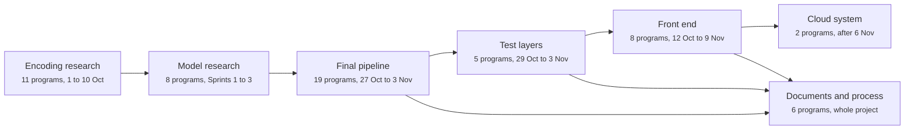
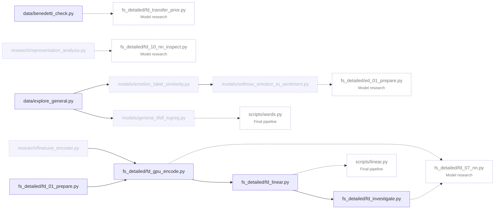
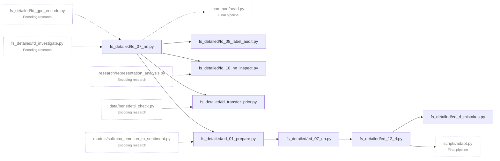
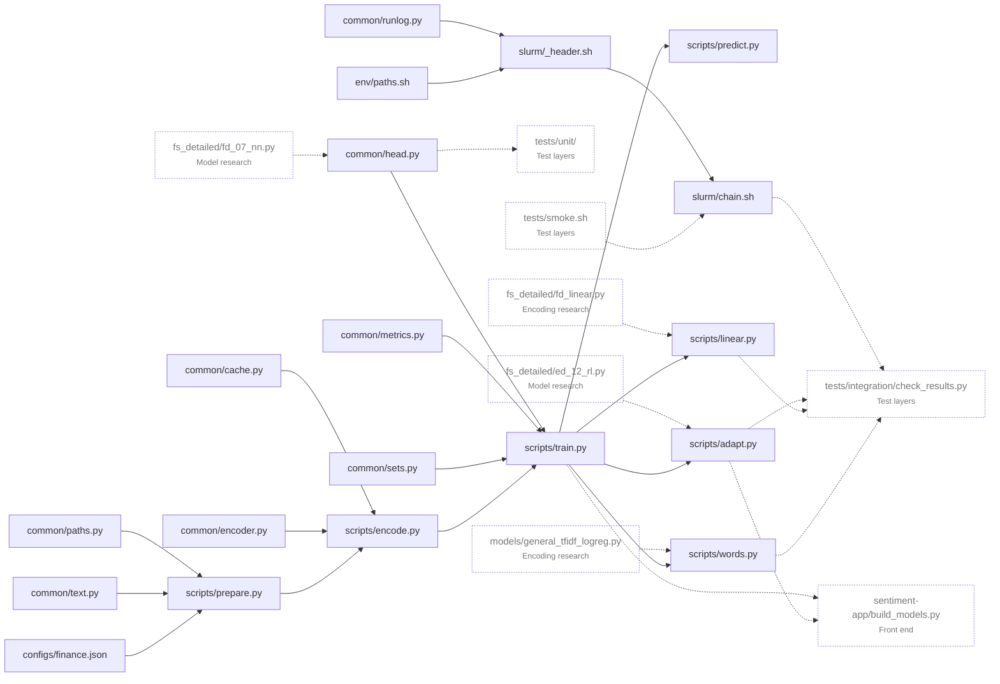
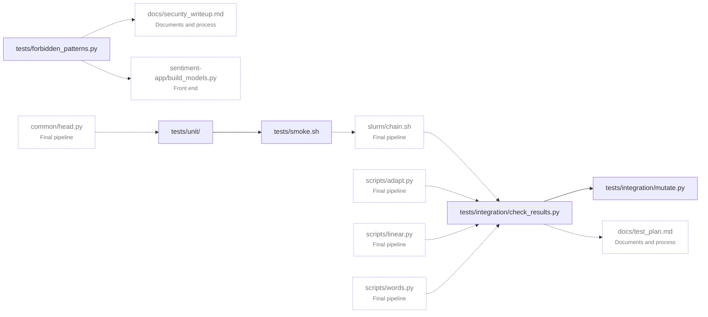
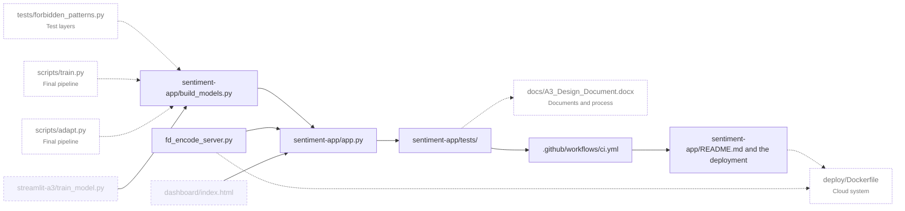
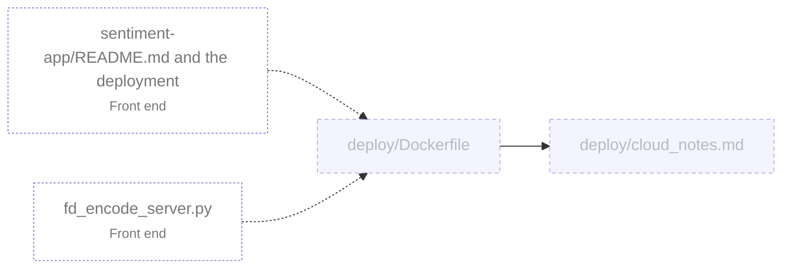
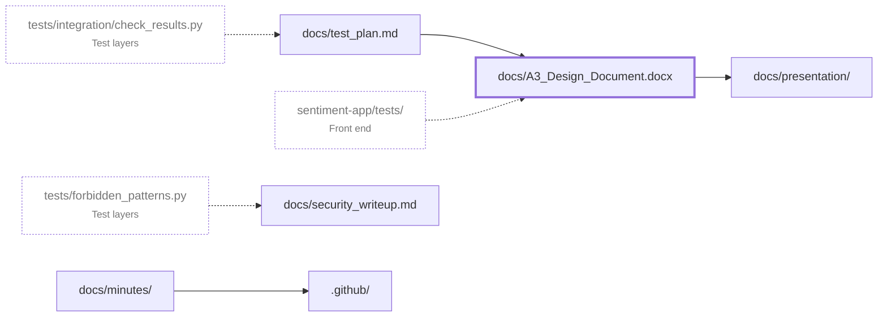
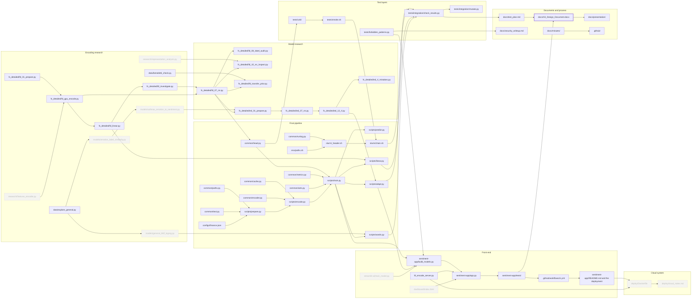

# Pipeline map

One box per program file, from the encoding research to the front end; an arrow means the box on the left feeds the one on the right. Dashed boxes were cancelled, heavy borders are the open work, and a dotted box in a phase diagram belongs to another phase. Each box has its own page under `programs/`.

## The phases

## Encoding research

First access to the SuperComputer, the first encoding pass, the first linear model and the data investigation.

## Model research

The research pipeline fs_detailed: the head search under the protocol, the audit, the inspection, the Dialogue Network and the reinforcement suite.

## Final pipeline

The final repository sentiment_heads: one configuration per corpus, nine common modules, seven scripts and the Slurm chain that ran end to end on 3 November.

## Test layers

Unit, smoke, integration and mutation, written before the step each one checks, plus the security scan.

## Front end

The Streamlit application, its model store, the encoder service, its 213 tests, CI and the deployment.

## Cloud system

Containers for the application and the encoder service, the model store from the release asset, hosting notes.

## Documents and process

The design document, the test plan, the presentation, the security write-up, the minutes and the repository protocol.

## The whole map

The same boxes and arrows in one picture. It is wide, so it is also kept as [pipeline.svg](pipeline.svg), which opens at full size.

## The boxes

| Phase | Program | Status | Page |
|---|---|---|---|
| Encoding research | `fs_detailed/fd_01_prepare.py` | Complete | [fs-detailed-fd-01-prepare-py.md](programs/fs-detailed-fd-01-prepare-py.md) |
| Encoding research | `fs_detailed/fd_gpu_encode.py` | Complete | [fs-detailed-fd-gpu-encode-py.md](programs/fs-detailed-fd-gpu-encode-py.md) |
| Encoding research | `fs_detailed/fd_linear.py` | Complete | [fs-detailed-fd-linear-py.md](programs/fs-detailed-fd-linear-py.md) |
| Encoding research | `fs_detailed/fd_investigate.py` | Complete | [fs-detailed-fd-investigate-py.md](programs/fs-detailed-fd-investigate-py.md) |
| Encoding research | `data/benedetti_check.py` | Complete | [data-benedetti-check-py.md](programs/data-benedetti-check-py.md) |
| Encoding research | `data/explore_general.py` | Complete | [data-explore-general-py.md](programs/data-explore-general-py.md) |
| Encoding research | `models/general_tfidf_logreg.py` | Cancelled | [models-general-tfidf-logreg-py.md](programs/models-general-tfidf-logreg-py.md) |
| Encoding research | `models/emotion_label_similarity.py` | Cancelled | [models-emotion-label-similarity-py.md](programs/models-emotion-label-similarity-py.md) |
| Encoding research | `models/softmax_emotion_to_sentiment.py` | Cancelled | [models-softmax-emotion-to-sentiment-py.md](programs/models-softmax-emotion-to-sentiment-py.md) |
| Encoding research | `research/finetune_encoder.py` | Cancelled | [research-finetune-encoder-py.md](programs/research-finetune-encoder-py.md) |
| Encoding research | `research/representation_analysis.py` | Cancelled | [research-representation-analysis-py.md](programs/research-representation-analysis-py.md) |
| Model research | `fs_detailed/fd_07_nn.py` | Complete | [fs-detailed-fd-07-nn-py.md](programs/fs-detailed-fd-07-nn-py.md) |
| Model research | `fs_detailed/fd_08_label_audit.py` | Complete | [fs-detailed-fd-08-label-audit-py.md](programs/fs-detailed-fd-08-label-audit-py.md) |
| Model research | `fs_detailed/fd_10_nn_inspect.py` | Complete | [fs-detailed-fd-10-nn-inspect-py.md](programs/fs-detailed-fd-10-nn-inspect-py.md) |
| Model research | `fs_detailed/fd_transfer_prior.py` | Complete | [fs-detailed-fd-transfer-prior-py.md](programs/fs-detailed-fd-transfer-prior-py.md) |
| Model research | `fs_detailed/ed_01_prepare.py` | Complete | [fs-detailed-ed-01-prepare-py.md](programs/fs-detailed-ed-01-prepare-py.md) |
| Model research | `fs_detailed/ed_07_nn.py` | Complete | [fs-detailed-ed-07-nn-py.md](programs/fs-detailed-ed-07-nn-py.md) |
| Model research | `fs_detailed/ed_12_rl.py` | Complete | [fs-detailed-ed-12-rl-py.md](programs/fs-detailed-ed-12-rl-py.md) |
| Model research | `fs_detailed/ed_rl_mistakes.py` | Complete | [fs-detailed-ed-rl-mistakes-py.md](programs/fs-detailed-ed-rl-mistakes-py.md) |
| Final pipeline | `common/paths.py` | Complete | [common-paths-py.md](programs/common-paths-py.md) |
| Final pipeline | `common/text.py` | Complete | [common-text-py.md](programs/common-text-py.md) |
| Final pipeline | `common/cache.py` | Complete | [common-cache-py.md](programs/common-cache-py.md) |
| Final pipeline | `common/encoder.py` | Complete | [common-encoder-py.md](programs/common-encoder-py.md) |
| Final pipeline | `common/head.py` | Complete | [common-head-py.md](programs/common-head-py.md) |
| Final pipeline | `common/metrics.py` | Complete | [common-metrics-py.md](programs/common-metrics-py.md) |
| Final pipeline | `common/sets.py` | Complete | [common-sets-py.md](programs/common-sets-py.md) |
| Final pipeline | `common/runlog.py` | Complete | [common-runlog-py.md](programs/common-runlog-py.md) |
| Final pipeline | `configs/finance.json` | Complete | [configs-finance-json.md](programs/configs-finance-json.md) |
| Final pipeline | `scripts/prepare.py` | Complete | [scripts-prepare-py.md](programs/scripts-prepare-py.md) |
| Final pipeline | `scripts/encode.py` | Complete | [scripts-encode-py.md](programs/scripts-encode-py.md) |
| Final pipeline | `scripts/train.py` | Complete | [scripts-train-py.md](programs/scripts-train-py.md) |
| Final pipeline | `scripts/predict.py` | Complete | [scripts-predict-py.md](programs/scripts-predict-py.md) |
| Final pipeline | `scripts/adapt.py` | Complete | [scripts-adapt-py.md](programs/scripts-adapt-py.md) |
| Final pipeline | `scripts/linear.py` | Complete | [scripts-linear-py.md](programs/scripts-linear-py.md) |
| Final pipeline | `scripts/words.py` | Complete | [scripts-words-py.md](programs/scripts-words-py.md) |
| Final pipeline | `env/paths.sh` | Complete | [env-paths-sh.md](programs/env-paths-sh.md) |
| Final pipeline | `slurm/_header.sh` | Complete | [slurm-header-sh.md](programs/slurm-header-sh.md) |
| Final pipeline | `slurm/chain.sh` | Complete | [slurm-chain-sh.md](programs/slurm-chain-sh.md) |
| Test layers | `tests/unit/` | Complete | [tests-unit.md](programs/tests-unit.md) |
| Test layers | `tests/smoke.sh` | Complete | [tests-smoke-sh.md](programs/tests-smoke-sh.md) |
| Test layers | `tests/integration/check_results.py` | Complete | [tests-integration-check-results-py.md](programs/tests-integration-check-results-py.md) |
| Test layers | `tests/integration/mutate.py` | Complete | [tests-integration-mutate-py.md](programs/tests-integration-mutate-py.md) |
| Test layers | `tests/forbidden_patterns.py` | Complete | [tests-forbidden-patterns-py.md](programs/tests-forbidden-patterns-py.md) |
| Front end | `sentiment-app/app.py` | Complete | [sentiment-app-app-py.md](programs/sentiment-app-app-py.md) |
| Front end | `sentiment-app/build_models.py` | Complete | [sentiment-app-build-models-py.md](programs/sentiment-app-build-models-py.md) |
| Front end | `fd_encode_server.py` | Complete | [fd-encode-server-py.md](programs/fd-encode-server-py.md) |
| Front end | `sentiment-app/tests/` | Complete | [sentiment-app-tests.md](programs/sentiment-app-tests.md) |
| Front end | `.github/workflows/ci.yml` | Complete | [github-workflows-ci-yml.md](programs/github-workflows-ci-yml.md) |
| Front end | `sentiment-app/README.md and the deployment` | Complete | [sentiment-app-readme-md-and-the-deployment.md](programs/sentiment-app-readme-md-and-the-deployment.md) |
| Front end | `streamlit-a3/train_model.py` | Cancelled | [streamlit-a3-train-model-py.md](programs/streamlit-a3-train-model-py.md) |
| Front end | `dashboard/index.html` | Cancelled | [dashboard-index-html.md](programs/dashboard-index-html.md) |
| Cloud system | `deploy/Dockerfile` | Cancelled | [deploy-dockerfile.md](programs/deploy-dockerfile.md) |
| Cloud system | `deploy/cloud_notes.md` | Cancelled | [deploy-cloud-notes-md.md](programs/deploy-cloud-notes-md.md) |
| Documents and process | `docs/A3_Design_Document.docx` | Under review | [docs-a3-design-document-docx.md](programs/docs-a3-design-document-docx.md) |
| Documents and process | `docs/test_plan.md` | Complete | [docs-test-plan-md.md](programs/docs-test-plan-md.md) |
| Documents and process | `docs/presentation/` | Complete | [docs-presentation.md](programs/docs-presentation.md) |
| Documents and process | `docs/security_writeup.md` | Complete | [docs-security-writeup-md.md](programs/docs-security-writeup-md.md) |
| Documents and process | `docs/minutes/` | Complete | [docs-minutes.md](programs/docs-minutes.md) |
| Documents and process | `.github/` | Complete | [github.md](programs/github.md) |

[Back to the backlog](README.md)
