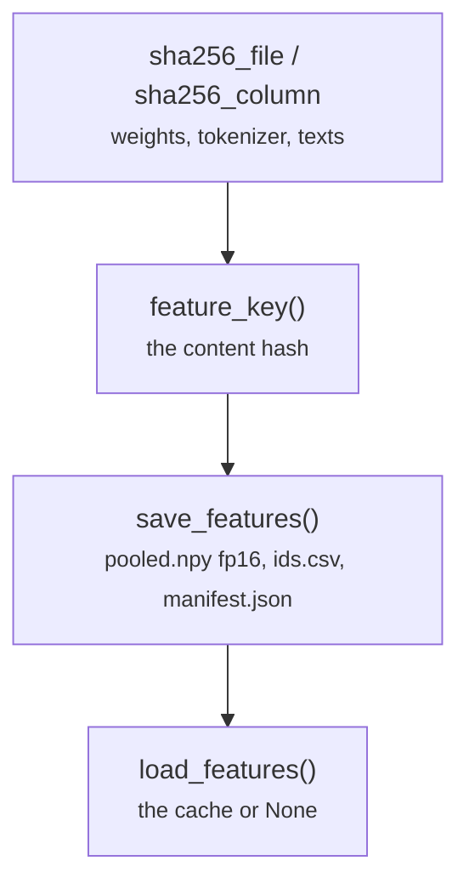

# common/cache.py

Final pipeline · Ricky · P3 · due 28 Oct 2026 · Complete

The content-hash feature cache: the key, the manifest, save and load.

## What it does

sha256_file and sha256_column digest the weights, the tokenizer and the text column; feature_key joins them with the pooling and the length settings; save_features writes pooled.npy in float16 with ids.csv and a manifest; load_features returns the cache or None. No hostname, working directory or job id goes into the manifest.

## Architecture

## Depends on

- [common/paths.py](common-paths-py.md)

## Affects

- [common/encoder.py](common-encoder-py.md)
- [common/sets.py](common-sets-py.md)
- [scripts/encode.py](scripts-encode-py.md)
- [tests/unit/](tests-unit.md)

## Reads and writes

| Reads | Writes |
|---|---|
| `nothing on disk` | `features/<key>/pooled.npy` |
|  | `ids.csv` |
|  | `manifest.json` |

## Todos

- [x] sha256 of weights, tokenizer and text column; save_features and load_features (Ricky, 0.25 h, 27 Oct)

Open items live as sub-issues of the program's issue: [open it on GitHub](https://github.com/hputhireth/Technology-and-Design/issues?q=is%3Aissue+label%3Aprogram+%22common-cache-py%22).

## Meetings

| Date | Rating | Note |
|---|---|---|
| 28 Oct 2026 | 4/5 | Walkthrough of the lean repository. |

## Hours

0.25 h over 1 todos, 0.25 h done. By week: Sprint 3 0.25 h.

[Back to the backlog](../README.md) · [Pipeline map](../PIPELINE.md)
