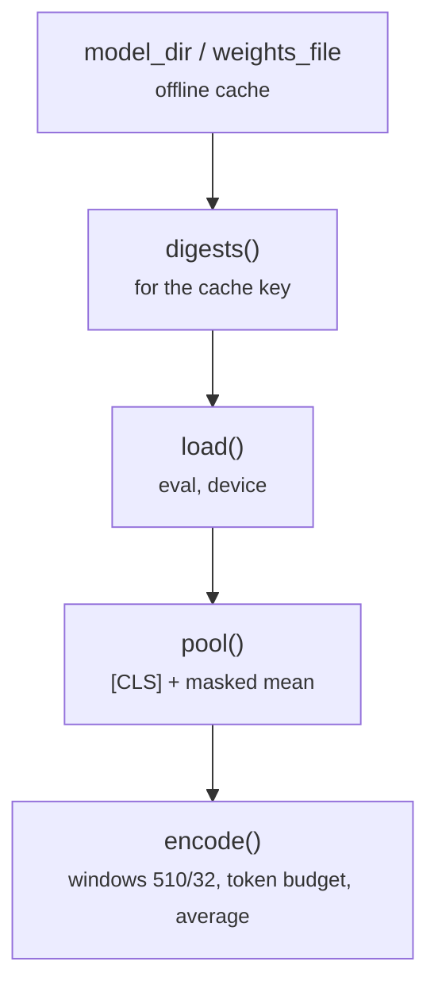

# common/encoder.py

Final pipeline · Ricky · P2 · due 28 Oct 2026 · Complete

Offline loading of the encoder, pooling, and the windowed forward pass.

## What it does

model_dir and weights_file find the encoder in the offline cache; digests hash the weights and the tokenizer for the cache key; load puts the model on the device in eval mode; pool joins the [CLS] vector with the masked mean; encode reads long texts in windows of 510 tokens with a 32-token overlap under a token budget and averages the windows. UT-E tests the window count at 1, 509, 510, 511, 988 and 989 tokens.

## Architecture

## Depends on

- [common/cache.py](common-cache-py.md)
- [common/paths.py](common-paths-py.md)
- `hf_cache/`

## Affects

- [scripts/encode.py](scripts-encode-py.md)
- [tests/unit/](tests-unit.md)
- [fd_encode_server.py](fd-encode-server-py.md)

## Reads and writes

| Reads | Writes |
|---|---|
| `hf_cache/` | `nothing on disk` |

## Todos

- [x] Offline loading, pooling and the windowed forward pass: 510 tokens, 32 overlap (Ricky, 0.5 h, 27 Oct)

Open items live as sub-issues of the program's issue: [open it on GitHub](https://github.com/hputhireth/Technology-and-Design/issues?q=is%3Aissue+label%3Aprogram+%22common-encoder-py%22).

## Meetings

| Date | Rating | Note |
|---|---|---|
| 28 Oct 2026 | 4/5 | Walkthrough of the lean repository. |

## Hours

0.5 h over 1 todos, 0.5 h done. By week: Sprint 3 0.5 h.

[Back to the backlog](../README.md) · [Pipeline map](../PIPELINE.md)
