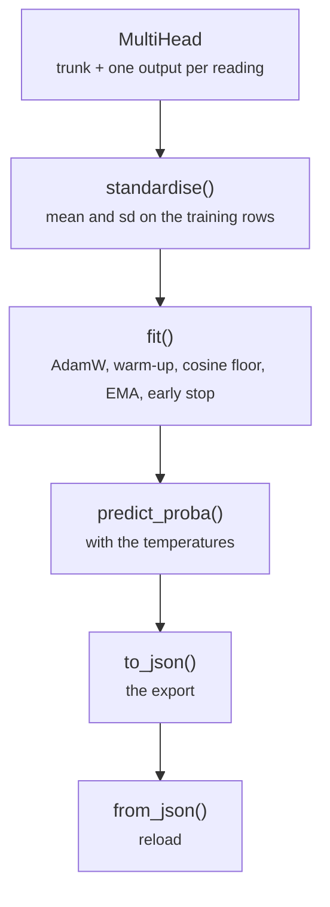

# common/head.py

Final pipeline · Ricky · P1 · due 29 Oct 2026 · Complete

The head, standardisation, the training loop, inference and the JSON form the application reads.

## What it does

MultiHead is a trunk of linear layers with one output layer per reading. standardise fits mean and sd on the training rows; fit runs AdamW with a one-epoch warm-up and a cosine floor, an EMA of the weights, smoothed cross-entropy and early stopping on the validation cross-entropy; predict_logits and predict_proba run inference with the temperatures; to_json and from_json are the export, float16 weights with the activations and temperatures, that the numpy pass, the integration checker and the application all read.

## Architecture

## Depends on

- [common/metrics.py](common-metrics-py.md)
- [fs_detailed/fd_07_nn.py](fs-detailed-fd-07-nn-py.md)
- [fs_detailed/ed_07_nn.py](fs-detailed-ed-07-nn-py.md)

## Affects

- [scripts/train.py](scripts-train-py.md)
- [scripts/predict.py](scripts-predict-py.md)
- [scripts/adapt.py](scripts-adapt-py.md)
- [scripts/linear.py](scripts-linear-py.md)
- [tests/unit/](tests-unit.md)
- [tests/integration/check_results.py](tests-integration-check-results-py.md)
- [sentiment-app/build_models.py](sentiment-app-build-models-py.md)

## Reads and writes

| Reads | Writes |
|---|---|
| `nothing on disk` | `nn_model.json (through the scripts)` |

## Todos

- [x] MultiHead and fit(): AdamW, warm-up, cosine floor, EMA, smoothed cross-entropy, early stopping (Ricky, 0.5 h, 28 Oct)
- [x] to_json / from_json: the export the application and the numpy pass read (Ricky, 0.5 h, 29 Oct)

Open items live as sub-issues of the program's issue: [open it on GitHub](https://github.com/hputhireth/Technology-and-Design/issues?q=is%3Aissue+label%3Aprogram+%22common-head-py%22).

## Meetings

| Date | Rating | Note |
|---|---|---|
| 29 Oct 2026 | 4/5 | Export format agreed with Hara: mean, sd, trunk, outputs, temperatures. |

## Hours

1 h over 2 todos, 1 h done. By week: Sprint 3 1 h.

[Back to the backlog](../README.md) · [Pipeline map](../PIPELINE.md)
