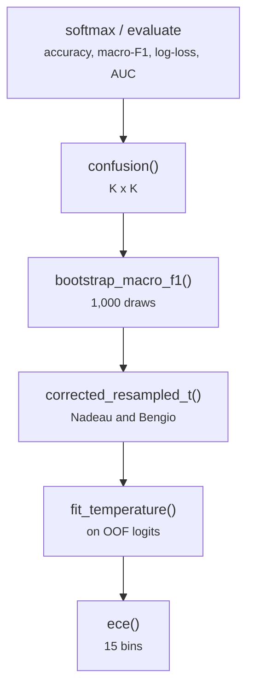

# common/metrics.py

Final pipeline · Ricky · P2 · due 1 Nov 2026 · Complete

Accuracy, macro-F1, log-loss, AUC, confusion, the bootstrap, the corrected resampled t-test and the temperature.

## What it does

evaluate returns every metric of a prediction table; bootstrap_macro_f1 gives the interval of the confirmation score; corrected_resampled_t is Nadeau and Bengio's test on paired fold-by-seed differences with the variance corrected for the overlap of training sets; fit_temperature finds the scalar that divides the logits; ece the calibration error over 15 bins.

## Architecture

## Depends on

- nothing recorded

## Affects

- [common/head.py](common-head-py.md)
- [scripts/train.py](scripts-train-py.md)
- [scripts/predict.py](scripts-predict-py.md)
- [scripts/adapt.py](scripts-adapt-py.md)
- [scripts/linear.py](scripts-linear-py.md)
- [scripts/words.py](scripts-words-py.md)
- [tests/unit/](tests-unit.md)

## Reads and writes

| Reads | Writes |
|---|---|
| `nothing on disk` | `nothing on disk` |

## Todos

- [x] evaluate, macro_f1, ece, bootstrap_macro_f1, fit_temperature (Ricky, 0.5 h, 28 Oct)
- [x] corrected_resampled_t, Nadeau and Bengio's overlap correction (Ricky, 0.5 h, 31 Oct)

Open items live as sub-issues of the program's issue: [open it on GitHub](https://github.com/hputhireth/Technology-and-Design/issues?q=is%3Aissue+label%3Aprogram+%22common-metrics-py%22).

## Meetings

| Date | Rating | Note |
|---|---|---|
| 31 Oct 2026 | 4/5 | The corrected t-test on known values at the live-testing check. |

## Hours

1 h over 2 todos, 1 h done. By week: Sprint 3 0.5 h, Sprint 4 0.5 h.

[Back to the backlog](../README.md) · [Pipeline map](../PIPELINE.md)
