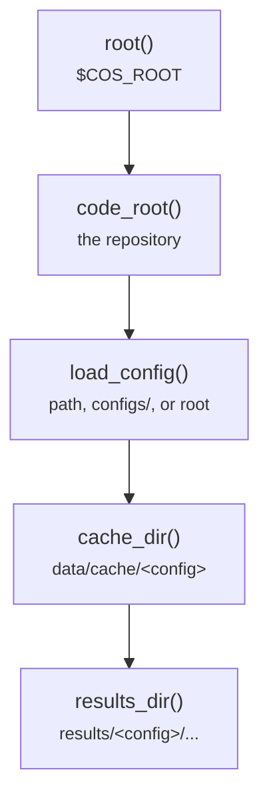

# common/paths.py

Final pipeline · Ricky · P3 · due 1 Nov 2026 · Complete

The folder layout under the project root: root(), load_config(), cache_dir(), results_dir().

## What it does

Every path a script touches goes through this module, so no absolute path appears in any tracked file. load_config finds a config as a path, as a name under configs/, or as a name under the project root, which is where the smoke chain writes its tiny configs.

## Architecture

## Depends on

- [configs/finance.json](configs-finance-json.md)
- `env/paths.sh`

## Affects

- [common/text.py](common-text-py.md)
- [common/cache.py](common-cache-py.md)
- [common/encoder.py](common-encoder-py.md)
- [common/sets.py](common-sets-py.md)
- [scripts/prepare.py](scripts-prepare-py.md)
- [scripts/encode.py](scripts-encode-py.md)
- [scripts/train.py](scripts-train-py.md)
- [scripts/predict.py](scripts-predict-py.md)
- [scripts/adapt.py](scripts-adapt-py.md)
- [scripts/linear.py](scripts-linear-py.md)
- [scripts/words.py](scripts-words-py.md)

## Reads and writes

| Reads | Writes |
|---|---|
| `configs/*.json` | `nothing on disk` |

## Todos

- [x] root(), load_config(), cache_dir(), results_dir() (Ricky, 0.25 h, 27 Oct)
- [x] A config is also found under the project root, for the smoke chain (Ricky, 0.25 h, 1 Nov)

Open items live as sub-issues of the program's issue: [open it on GitHub](https://github.com/hputhireth/Technology-and-Design/issues?q=is%3Aissue+label%3Aprogram+%22common-paths-py%22).

## Meetings

| Date | Rating | Note |
|---|---|---|
| 28 Oct 2026 | 4/5 | Walkthrough of the lean repository at the live-testing check. |

## Hours

0.5 h over 2 todos, 0.5 h done. By week: Sprint 3 0.25 h, Sprint 4 0.25 h.

[Back to the backlog](../README.md) · [Pipeline map](../PIPELINE.md)
