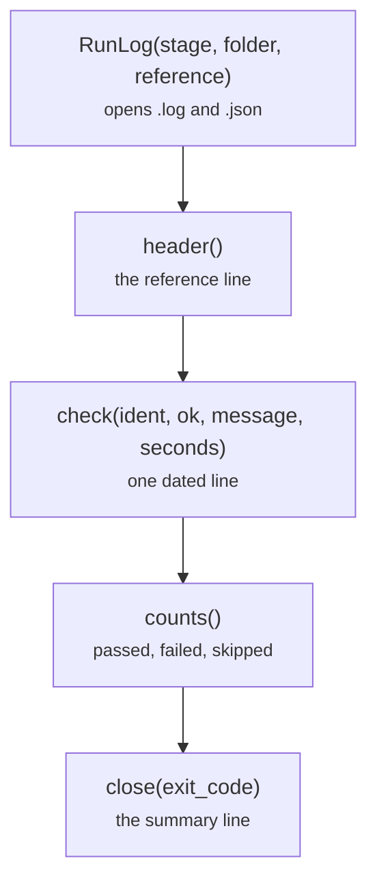

# common/runlog.py

Final pipeline · Ricky · P2 · due 1 Nov 2026 · Complete

The dated PASS/FAIL log every test layer and the chain write: one line per check, a .json mirror, no host or path.

## What it does

RunLog opens <stage>_<date>.log and its .json mirror under logs/, writes a header with the reference of the design document, one dated line per check with its id, message and seconds, counts the verdicts and closes with the PASS or FAIL summary line and the exit code. The forbidden-pattern scan keeps hosts, logins and paths out of it.

## Architecture

## Depends on

- nothing recorded

## Affects

- [tests/unit/](tests-unit.md)
- [tests/smoke.sh](tests-smoke-sh.md)
- [tests/integration/check_results.py](tests-integration-check-results-py.md)
- [tests/integration/mutate.py](tests-integration-mutate-py.md)
- [slurm/_header.sh](slurm-header-sh.md)

## Reads and writes

| Reads | Writes |
|---|---|
| `nothing on disk` | `logs/<stage>_<date>.log` |
|  | `logs/<stage>_<date>.json` |

## Todos

- [x] RunLog: one dated PASS or FAIL line per check, a .json mirror, no host or path (Ricky, 0.5 h, 1 Nov)

Open items live as sub-issues of the program's issue: [open it on GitHub](https://github.com/hputhireth/Technology-and-Design/issues?q=is%3Aissue+label%3Aprogram+%22common-runlog-py%22).

## Meetings

| Date | Rating | Note |
|---|---|---|
| 1 Nov 2026 | 4/5 | Log format shown at the live-testing check; the same line in every layer. |

## Hours

0.5 h over 1 todos, 0.5 h done. By week: Sprint 4 0.5 h.

[Back to the backlog](../README.md) · [Pipeline map](../PIPELINE.md)
