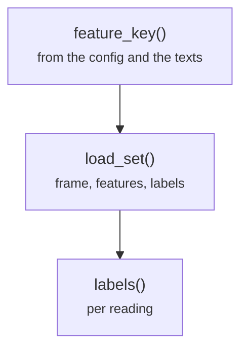

# common/sets.py

Final pipeline · Ricky · P3 · due 28 Oct 2026 · Complete

A prepared table with its cached features and its labels, in one call.

## What it does

load_set reads the prepared table of a set, finds its features under the content hash and returns the frame, the feature matrix and the label arrays per reading; labels maps the columns onto the readings' classes.

## Architecture

## Depends on

- [common/cache.py](common-cache-py.md)
- [common/encoder.py](common-encoder-py.md)
- [common/paths.py](common-paths-py.md)

## Affects

- [scripts/train.py](scripts-train-py.md)
- [scripts/predict.py](scripts-predict-py.md)
- [scripts/adapt.py](scripts-adapt-py.md)
- [scripts/linear.py](scripts-linear-py.md)

## Reads and writes

| Reads | Writes |
|---|---|
| `data/cache/<config>/<set>.csv` | `nothing on disk` |
| `features/<key>/pooled.npy` |  |

## Todos

- [x] load_set: the prepared table with its cached features and labels (Ricky, 0.25 h, 28 Oct)

Open items live as sub-issues of the program's issue: [open it on GitHub](https://github.com/hputhireth/Technology-and-Design/issues?q=is%3Aissue+label%3Aprogram+%22common-sets-py%22).

## Meetings

| Date | Rating | Note |
|---|---|---|
| 28 Oct 2026 | 4/5 | Walkthrough of the lean repository. |

## Hours

0.25 h over 1 todos, 0.25 h done. By week: Sprint 3 0.25 h.

[Back to the backlog](../README.md) · [Pipeline map](../PIPELINE.md)
