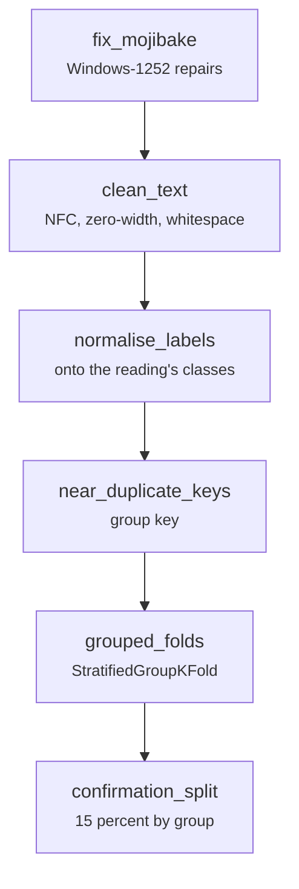

# common/text.py

Final pipeline · Ricky · P2 · due 28 Oct 2026 · Complete

Cleaning, label normalisation, duplicate keys, groups and the grouped splits.

## What it does

fix_mojibake and clean_text repair and normalise a text; normalise_labels maps a column onto a reading's classes; near_duplicate_keys and run_keys build the group keys; grouped_folds and confirmation_split hold groups together across every split. UT-D and UT-N test every branch against closed-form answers.

## Architecture

## Depends on

- [common/paths.py](common-paths-py.md)

## Affects

- [scripts/prepare.py](scripts-prepare-py.md)
- [scripts/train.py](scripts-train-py.md)
- [scripts/adapt.py](scripts-adapt-py.md)
- [scripts/linear.py](scripts-linear-py.md)
- [scripts/words.py](scripts-words-py.md)
- [tests/unit/](tests-unit.md)

## Reads and writes

| Reads | Writes |
|---|---|
| `nothing on disk` | `nothing on disk` |

## Todos

- [x] Cleaning, labels, duplicate keys and the grouped splits, lifted from the research pipeline and trimmed (Ricky, 0.5 h, 27 Oct)

Open items live as sub-issues of the program's issue: [open it on GitHub](https://github.com/hputhireth/Technology-and-Design/issues?q=is%3Aissue+label%3Aprogram+%22common-text-py%22).

## Meetings

| Date | Rating | Note |
|---|---|---|
| 28 Oct 2026 | 4/5 | Walkthrough of the lean repository. |

## Hours

0.5 h over 1 todos, 0.5 h done. By week: Sprint 3 0.5 h.

[Back to the backlog](../README.md) · [Pipeline map](../PIPELINE.md)
