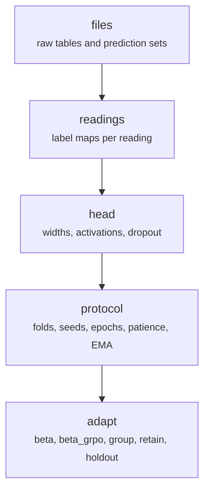

# configs/finance.json, configs/dialogue.json

Final pipeline · Ricky · P2 · due 30 Oct 2026 · Complete

One configuration per corpus: the files, the labels, the head, the protocol and the adaptation settings.

## What it does

Everything a script needs to know about a corpus: the raw files and the prediction sets, the readings with their label maps, the head (widths, activations, dropout, weight decay), the protocol (confirmation fraction 0.15, 5 folds, 3 seeds, 100 epochs, patience 10, warm-up 1, cosine floor 0.1, EMA 0.999) and the adaptation block (beta 0.3, beta_grpo 0.1, group 4, retain 1, 20 epochs, lr 3e-4, batch 256, holdout 0.5). The dialogue config adds the emotion reading and grouping by conversation.

## Architecture

## Depends on

- [fs_detailed/fd_07_nn.py](fs-detailed-fd-07-nn-py.md)
- [fs_detailed/ed_07_nn.py](fs-detailed-ed-07-nn-py.md)
- [fs_detailed/ed_12_rl.py](fs-detailed-ed-12-rl-py.md)

## Affects

- [common/paths.py](common-paths-py.md)
- [scripts/prepare.py](scripts-prepare-py.md)
- [scripts/encode.py](scripts-encode-py.md)
- [scripts/train.py](scripts-train-py.md)
- [scripts/predict.py](scripts-predict-py.md)
- [scripts/adapt.py](scripts-adapt-py.md)
- [scripts/linear.py](scripts-linear-py.md)
- [scripts/words.py](scripts-words-py.md)
- [tests/integration/check_results.py](tests-integration-check-results-py.md)

## Reads and writes

| Reads | Writes |
|---|---|
| `nothing on disk` | `configs/finance.json` |
|  | `configs/dialogue.json` |

## Todos

- [x] One configuration file per corpus: files, labels, head, protocol, the adaptation settings (Ricky, 0.5 h, 27 Oct)

Open items live as sub-issues of the program's issue: [open it on GitHub](https://github.com/hputhireth/Technology-and-Design/issues?q=is%3Aissue+label%3Aprogram+%22configs-finance-json%22).

## Meetings

| Date | Rating | Note |
|---|---|---|
| 27 Oct 2026 | 4/5 | Lean repository agreed: one config file per corpus. |

## Hours

0.5 h over 1 todos, 0.5 h done. By week: Sprint 3 0.5 h.

[Back to the backlog](../README.md) · [Pipeline map](../PIPELINE.md)
