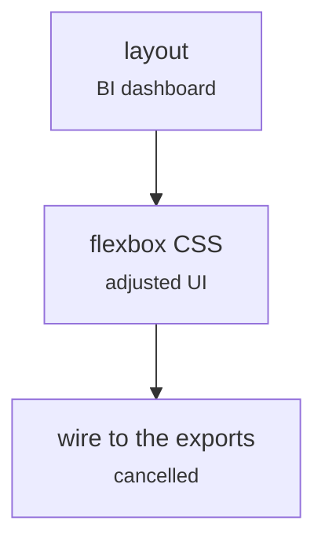

# dashboard/index.html (BI dashboard layout)

Front end · Johnny · P5 · due 18 Oct 2026 · Cancelled

Johnny's BI dashboard layout with flexbox, 18 October. Dropped at the Sprint 2 review: the Streamlit app is the front end.

> Dropped on 23 October.

## What it does

A static dashboard layout in HTML and CSS for the results, started while the Streamlit experiments were running. The two front ends would have duplicated each other, so the dashboard was dropped and Johnny's front-end work became supervision of the Streamlit pages.

## Architecture

## Depends on

- nothing recorded

## Affects

- [sentiment-app/app.py](sentiment-app-app-py.md)

## Reads and writes

| Reads | Writes |
|---|---|
| `nothing on disk` | `nothing on disk` |

## Todos

- [x] BI dashboard layout (Johnny, 2.5 h, 18 Oct)
- [x] Adjust the UI, flexbox in CSS (Johnny, 1.5 h, 18 Oct)
- [ ] ~~Wire the dashboard to the exports~~ (Johnny, 0.5 h, 23 Oct), cancelled

Open items live as sub-issues of the program's issue: [open it on GitHub](https://github.com/hputhireth/Technology-and-Design/issues?q=is%3Aissue+label%3Aprogram+%22dashboard-index-html%22).

## Meetings

| Date | Rating | Note |
|---|---|---|
| 23 Oct 2026 | 2/5 | Dropped at the Sprint 2 review: one front end. |

## Hours

4.5 h over 3 todos, 4 h done. By week: Sprint 2 4.5 h.

[Back to the backlog](../README.md) · [Pipeline map](../PIPELINE.md)
