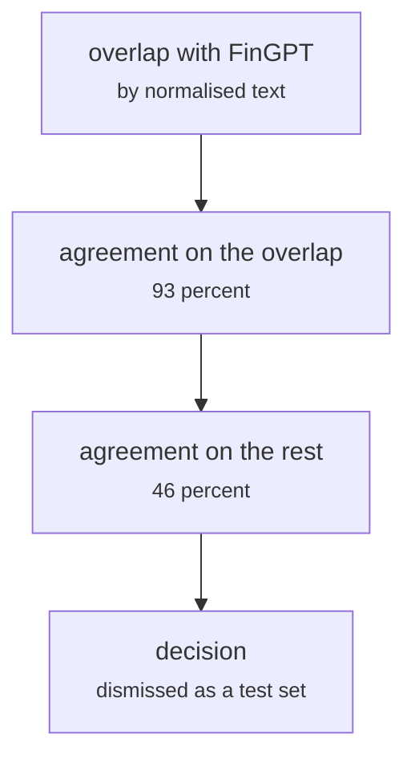

# data/benedetti_check.py

Encoding research · Johnny · P4 · due 9 Oct 2026 · Complete

The check that dismissed the Kaggle Finance News Sentiments file as a test set: undocumented labels, 93 against 46 percent agreement.

## What it does

Johnny flagged the Benedetti file: undocumented labels and an overlap with FinGPT. Ricky's label analysis confirmed it: the same head agrees with 93 percent of its rows that are also in FinGPT and 46 percent of the rest, so the labels are not learnable in the way SEntFiN's are. SEntFiN 1.0 stayed the external test.

## Architecture

## Depends on

- [fs_detailed/fd_07_nn.py](fs-detailed-fd-07-nn-py.md)

## Affects

- `the dataset table of the design document`

## Reads and writes

| Reads | Writes |
|---|---|
| `Finance News Sentiments (Kaggle), 32,569 rows` | `section II.F of the design document` |
| `results/fd/train/nn/nn_model.json` |  |

## Todos

- [x] Flag the Benedetti file: undocumented labels, overlap with FinGPT (Johnny, 1.5 h, 7 Oct)
- [ ] ~~Prepare Benedetti as the external test set~~ (Johnny, 0.5 h, 9 Oct), cancelled
- [x] Label analysis with the head: 93 percent on the overlap, 46 percent on the rest (Ricky, 1 h, 21 Oct)
- [x] The Benedetti decision written into section II.F (Johnny, 1 h, 27 Oct)

Open items live as sub-issues of the program's issue: [open it on GitHub](https://github.com/hputhireth/Technology-and-Design/issues?q=is%3Aissue+label%3Aprogram+%22data-benedetti-check-py%22).

## Meetings

| Date | Rating | Note |
|---|---|---|
| 9 Oct 2026 | 4/5 | Dismissed as a test set; SEntFiN 1.0 stays the external test. |

## Hours

4 h over 4 todos, 3.5 h done. By week: Sprint 2 1 h, Sprint 3 1 h, Before the sprints 2 h.

[Back to the backlog](../README.md) · [Pipeline map](../PIPELINE.md)
