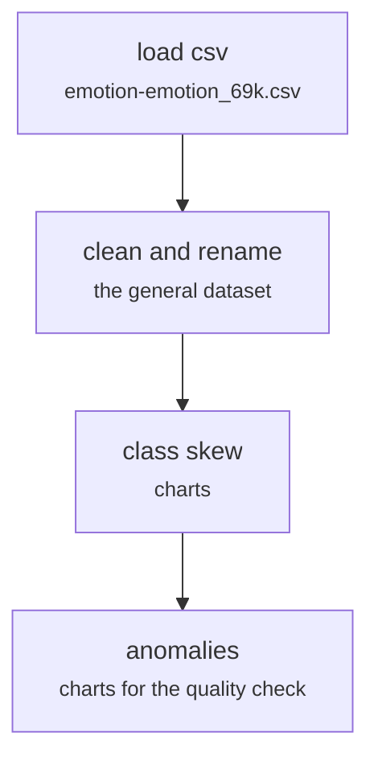

# data/explore_general.py

Encoding research · Johnny · P4 · due 5 Oct 2026 · Complete

Johnny's cleaning and exploratory analysis of the general dataset (emotion-emotion_69k.csv): skew, anomalies, quality charts.

## What it does

Loads the general emotion dataset, cleans it, renames the files to say what they hold, and draws the class skew and the anomaly charts the team used for its quality check. The exploration fed the data-quality follow-up of the label audit; the general-domain models built on it were exploratory only.

## Architecture

## Depends on

- `data/raw/ of the public repository`

## Affects

- [models/general_tfidf_logreg.py](models-general-tfidf-logreg-py.md)
- [models/emotion_label_similarity.py](models-emotion-label-similarity-py.md)
- [fs_detailed/fd_08_label_audit.py](fs-detailed-fd-08-label-audit-py.md)

## Reads and writes

| Reads | Writes |
|---|---|
| `emotion-emotion_69k.csv` | `figures of the quality check` |

## Todos

- [x] Load and clean emotion-emotion_69k.csv; rename the files to the general dataset (Johnny, 2.5 h, 5 Oct)
- [x] Class skew and anomaly charts for the quality check (Johnny, 1.5 h, 5 Oct)
- [x] Remove the test files and the irrelevant files from the repository (Johnny, 0.5 h, 7 Oct)

Open items live as sub-issues of the program's issue: [open it on GitHub](https://github.com/hputhireth/Technology-and-Design/issues?q=is%3Aissue+label%3Aprogram+%22data-explore-general-py%22).

## Meetings

| Date | Rating | Note |
|---|---|---|
| 5 Oct 2026 | 4/5 | Quality charts reviewed on the first call of the week. |

## Hours

4.5 h over 3 todos, 4.5 h done. By week: Before the sprints 4.5 h.

[Back to the backlog](../README.md) · [Pipeline map](../PIPELINE.md)
