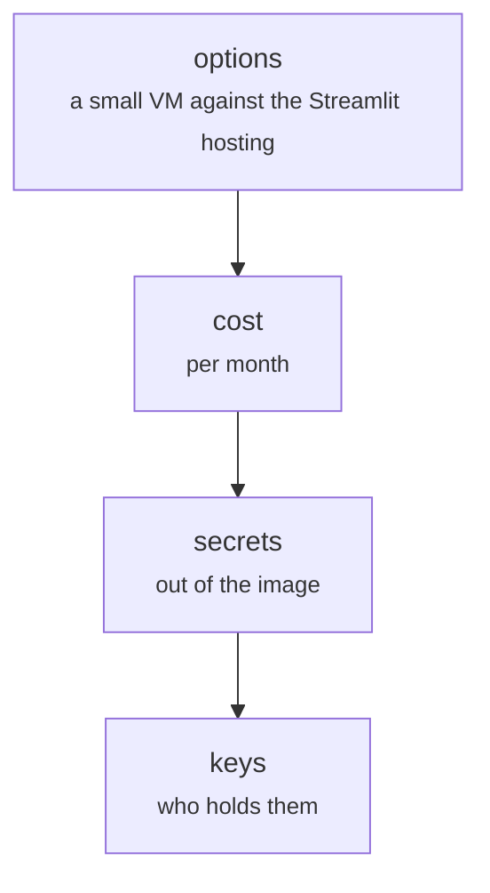

# deploy/cloud_notes.md

Cloud system · Hara · P4 · due 11 Nov 2026 · Not started

Hosting options and cost, secrets and the model store out of the image.

## What it does

The notes that decide where the containers run: a small virtual machine against the Streamlit hosting, the monthly cost, how the secrets and the model store stay out of the image, and who holds the keys.

## Architecture

## Depends on

- [deploy/Dockerfile](deploy-dockerfile.md)

## Affects

- nothing recorded

## Reads and writes

| Reads | Writes |
|---|---|
| `nothing on disk` | `deploy/cloud_notes.md` |

## Todos

- [ ] Hosting options and cost: a small VM against the Streamlit hosting (Hara, 1 h, 10 Nov), todo
- [ ] Secrets and the model store out of the image (Johnny, 1 h, 10 Nov), todo

Open items live as sub-issues of the program's issue: [open it on GitHub](https://github.com/hputhireth/Technology-and-Design/issues?q=is%3Aissue+label%3Aprogram+%22deploy-cloud-notes-md%22).

## Meetings

| Date | Rating | Note |
|---|---|---|
| 6 Nov 2026 | pending | To be scoped after the review with Dr Vo. |

## Hours

2 h over 2 todos, 0 h done. By week: Final week 2 h.

[Back to the backlog](../README.md) · [Pipeline map](../PIPELINE.md)
