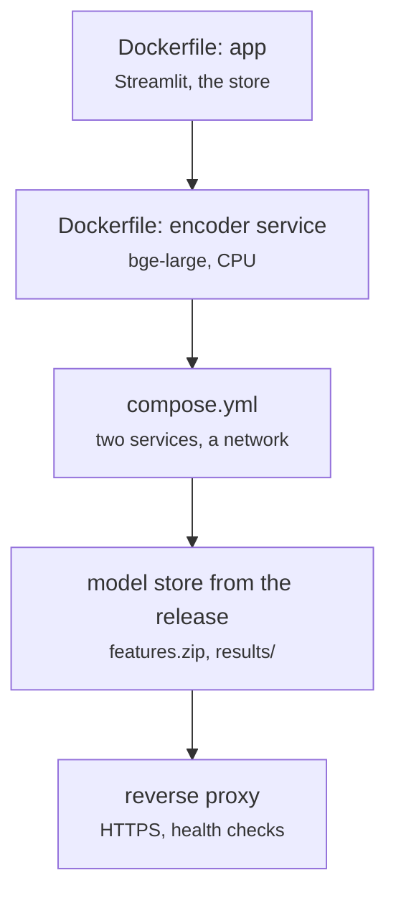

# deploy/Dockerfile, deploy/compose.yml

Cloud system · Hara · P3 · due 11 Nov 2026 · Not started

Two containers, the application and the encoder service, CPU only, with the model store from the release asset and HTTPS behind a reverse proxy.

## What it does

The cloud system of the roadmap: the application and the encoder service as two containers that run on a CPU, the model store built from the results folder and the release asset features.zip, health checks, and HTTPS behind a reverse proxy. To be scoped after the review with Dr Vo.

## Architecture

## Depends on

- [sentiment-app/app.py](sentiment-app-app-py.md)
- [fd_encode_server.py](fd-encode-server-py.md)
- [sentiment-app/build_models.py](sentiment-app-build-models-py.md)

## Affects

- [deploy/cloud_notes.md](deploy-cloud-notes-md.md)

## Reads and writes

| Reads | Writes |
|---|---|
| `the release asset features.zip` | `images and compose.yml` |
| `results/` |  |

## Todos

- [ ] Two containers: the application and the encoder service, CPU only (Hara, 3 h, 9 Nov), todo
- [ ] The model store from the release asset features.zip and the results folder (Ricky, 2 h, 10 Nov), todo
- [ ] HTTPS behind a reverse proxy; health checks (Hara, 2 h, 11 Nov), todo

Open items live as sub-issues of the program's issue: [open it on GitHub](https://github.com/hputhireth/Technology-and-Design/issues?q=is%3Aissue+label%3Aprogram+%22deploy-dockerfile%22).

## Meetings

| Date | Rating | Note |
|---|---|---|
| 6 Nov 2026 | pending | To be scoped after the review with Dr Vo. |

## Hours

7 h over 3 todos, 0 h done. By week: Final week 7 h.

[Back to the backlog](../README.md) · [Pipeline map](../PIPELINE.md)
