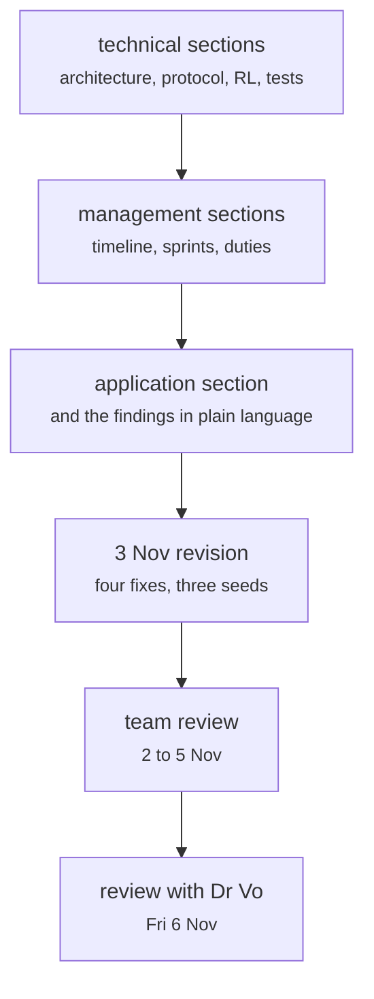

# docs/A3_Design_Document.docx

Documents and process · Ricky · P1 · due 6 Nov 2026 · Under review

The design document: technical sections by Ricky, management sections by Johnny, the application by Hara; revised 3 November; team review to 5 November.

## What it does

Every number in it is read from the chain of 3 November or marked as the research pipeline's. The 1 November version carried the test plan references; the 3 November revision added the chain's four fixes and the three seeds. The team reviewed it from 2 to 5 November; the review with Dr Vo is on Friday 6 November at 2:30 pm.

## Architecture

## Depends on

- [slurm/chain.sh](slurm-chain-sh.md)
- [tests/integration/check_results.py](tests-integration-check-results-py.md)
- [sentiment-app/tests/](sentiment-app-tests.md)
- [docs/test_plan.md](docs-test-plan-md.md)

## Affects

- [docs/presentation/](docs-presentation.md)

## Reads and writes

| Reads | Writes |
|---|---|
| `results/**` | `A3_Design_Document_3Nov.docx` |
| `logs/*_20261103.log` |  |

## Todos

- [x] Technical sections, the test plan references, the numbers from the 3 November run (Ricky, 1 h, 1 Nov)
- [x] Management sections, timeline and milestones (Johnny, 3 h, 1 Nov)
- [x] The 3 November revision: the chain's four fixes and the three seeds (Ricky, 0.5 h, 3 Nov)
- [ ] Team review of the document, the test plan and the deck (Johnny, 2 h, 4 Nov), in review
- [ ] Review with Dr Vo, Fri 6 Nov 2:30 pm (Johnny, 0.5 h, 6 Nov), todo
- [x] Application section and the findings in plain language (Hara, 1 h, 1 Nov)
- [x] Review of the A2 revision before the SuperComputer work (Hara, 2 h, 7 Oct)

Open items live as sub-issues of the program's issue: [open it on GitHub](https://github.com/hputhireth/Technology-and-Design/issues?q=is%3Aissue+label%3Aprogram+%22docs-a3-design-document-docx%22).

## Meetings

| Date | Rating | Note |
|---|---|---|
| 1 Nov 2026 | 4/5 | The 1 November version read through at the Sunday session. |
| 4 Nov 2026 | 4/5 | Team review: changes highlighted. |
| 6 Nov 2026 | pending | Review with Dr Vo, 2:30 to 3:00 pm. |

## Hours

10 h over 7 todos, 7.5 h done. By week: Sprint 4 8 h, Before the sprints 2 h.

[Back to the backlog](../README.md) · [Pipeline map](../PIPELINE.md)
