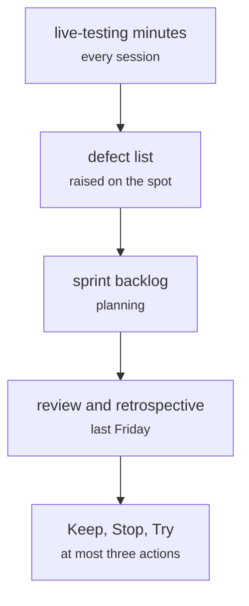

# docs/minutes/ (minutes, the defect log, the backlog)

Documents and process · Johnny · P2 · due 6 Nov 2026 · Complete

Johnny's record of every session: minutes, the defect list raised at the live-testing checks, the sprint backlogs and the retrospectives.

## What it does

Each session starts with a live-testing check and ends in the minutes and the defect list; each sprint has its planning record, its review and its Keep, Stop, Try. Sprint 4's review and retrospective are on Friday 6 November.

## Architecture

## Depends on

- nothing recorded

## Affects

- [docs/A3_Design_Document.docx](docs-a3-design-document-docx.md)
- [.github/](github.md)

## Reads and writes

| Reads | Writes |
|---|---|
| `nothing on disk` | `docs/minutes/sprint<n>.md` |

## Todos

- [x] Sprint 1 minutes and the defect list (Johnny, 1.5 h, 16 Oct)
- [x] Sprint 2 minutes and the defect list (Johnny, 1.5 h, 23 Oct)
- [x] Sprint 3 minutes and the defect list (Johnny, 1.5 h, 30 Oct)
- [x] Sprint 4 minutes and the retrospective (Johnny, 1.5 h, 6 Nov)
- [x] Canvas submission checklist (Johnny, 1 h, 11 Nov)
- [x] Dashboard and splits review for Sprint 3 (Johnny, 1 h, 24 Oct)
- [x] Retrospective actions onto the board (Johnny, 1 h, 7 Nov)

Open items live as sub-issues of the program's issue: [open it on GitHub](https://github.com/hputhireth/Technology-and-Design/issues?q=is%3Aissue+label%3Aprogram+%22docs-minutes%22).

## Meetings

| Date | Rating | Note |
|---|---|---|
| 16 Oct 2026 | 4/5 | Sprint 1 review and retrospective. |
| 23 Oct 2026 | 4/5 | Sprint 2 review and retrospective. |
| 30 Oct 2026 | 4/5 | Sprint 3 review and retrospective. |
| 6 Nov 2026 | pending | Sprint 4 review and retrospective. |

## Hours

9 h over 7 todos, 9 h done. By week: Sprint 1 1.5 h, Sprint 2 1.5 h, Sprint 3 2.5 h, Sprint 4 1.5 h, Final week 2 h.

[Back to the backlog](../README.md) · [Pipeline map](../PIPELINE.md)
