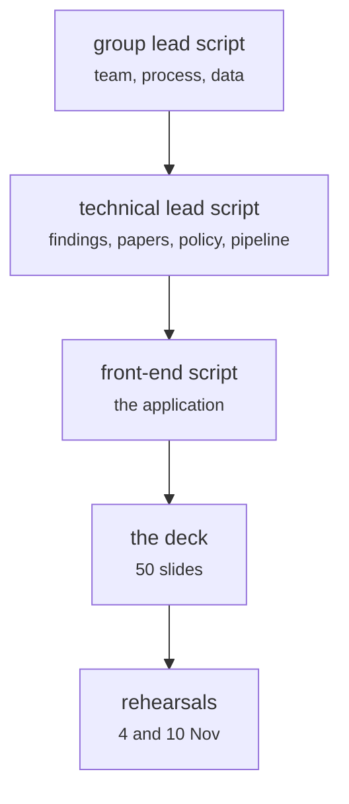

# docs/presentation/ (the deck and the three scripts)

Documents and process · Johnny · P1 · due 11 Nov 2026 · In progress

The 50-slide deck and the three scripts: group lead (team, process, data), technical lead (findings, papers, policy, pipeline), front end.

## What it does

Johnny's script covers the team, the process and the data; Ricky's the findings, the papers, the policy and the pipeline, with the deck; Hara's the application and the findings in plain language. First rehearsal on 4 November; the GRPO slide is to be updated from the 3 November run; the final rehearsal is on 10 November.

## Architecture

## Depends on

- [docs/A3_Design_Document.docx](docs-a3-design-document-docx.md)
- [scripts/adapt.py](scripts-adapt-py.md)
- [sentiment-app/README.md and the deployment](sentiment-app-readme-md-and-the-deployment.md)

## Affects

- nothing recorded

## Reads and writes

| Reads | Writes |
|---|---|
| `A3_Design_Document_3Nov.docx` | `the deck` |
| `results/**` | `three scripts` |

## Todos

- [x] Group lead script: team, process, data (Johnny, 2 h, 1 Nov)
- [x] Technical lead script and the 50-slide deck (Ricky, 1 h, 1 Nov)
- [ ] First rehearsal of the three scripts (Johnny, 2 h, 5 Nov), in progress
- [ ] Final rehearsal (Johnny, 2 h, 10 Nov), todo
- [ ] Final rehearsal (Ricky, 2 h, 10 Nov), todo
- [ ] Final rehearsal (Hara, 2 h, 10 Nov), todo
- [x] Front-end script: the application and the findings in plain language (Hara, 1 h, 2 Nov)
- [ ] GRPO slide updated from the 3 November run (Ricky, 1 h, 7 Nov), todo

Open items live as sub-issues of the program's issue: [open it on GitHub](https://github.com/hputhireth/Technology-and-Design/issues?q=is%3Aissue+label%3Aprogram+%22docs-presentation%22).

## Meetings

| Date | Rating | Note |
|---|---|---|
| 4 Nov 2026 | 4/5 | First rehearsal of the three scripts. |
| 10 Nov 2026 | pending | Final rehearsal. |

## Hours

13 h over 8 todos, 4 h done. By week: Sprint 4 6 h, Final week 7 h.

[Back to the backlog](../README.md) · [Pipeline map](../PIPELINE.md)
