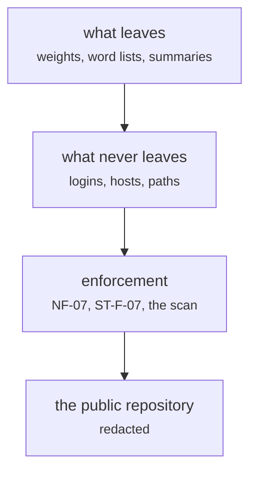

# docs/security_writeup.md

Documents and process · Ricky · P2 · due 30 Oct 2026 · Complete

What crosses out of the SuperComputer and what never does: float16 weights, word lists and JSON summaries out; logins, hosts and paths never.

## What it does

Why the code is on a private repository, why the research ran on the SuperComputer, what leaves it, how the application's tests and the static scan enforce the rule, and how the public repository carries the login redacted.

## Architecture

## Depends on

- [tests/forbidden_patterns.py](tests-forbidden-patterns-py.md)

## Affects

- [docs/A3_Design_Document.docx](docs-a3-design-document-docx.md)
- [sentiment-app/README.md and the deployment](sentiment-app-readme-md-and-the-deployment.md)

## Reads and writes

| Reads | Writes |
|---|---|
| `nothing on disk` | `docs/security_writeup.md` |

## Todos

- [x] What leaves the SuperComputer: float16 weights, word lists, JSON summaries (Ricky, 0.5 h, 26 Oct)
- [x] The redacted public repository (Ricky, 0.5 h, 30 Oct)
- [x] Review of the security write-up (Johnny, 1 h, 30 Oct)

Open items live as sub-issues of the program's issue: [open it on GitHub](https://github.com/hputhireth/Technology-and-Design/issues?q=is%3Aissue+label%3Aprogram+%22docs-security-writeup-md%22).

## Meetings

| Date | Rating | Note |
|---|---|---|
| 30 Oct 2026 | 4/5 | Reviewed at the Sprint 3 review. |

## Hours

2 h over 3 todos, 2 h done. By week: Sprint 3 2 h.

[Back to the backlog](../README.md) · [Pipeline map](../PIPELINE.md)
