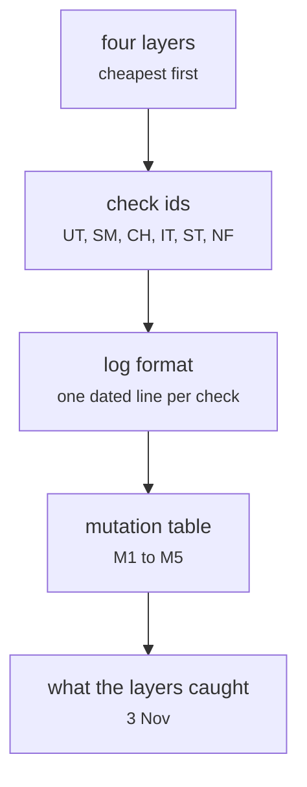

# docs/test_plan.md

Documents and process · Ricky · P2 · due 3 Nov 2026 · Complete

The test plan: four layers, cheapest first, every check id, the mutation table and what the layers caught on 3 November.

## What it does

Names the layers (unit, smoke, integration, mutation, and the application's 213 tests), the id scheme of every check, the log format, the five seeded faults and the checks that catch them, and the four faults the layers caught before the chain passed.

## Architecture

## Depends on

- [tests/unit/](tests-unit.md)
- [tests/smoke.sh](tests-smoke-sh.md)
- [tests/integration/check_results.py](tests-integration-check-results-py.md)
- [tests/integration/mutate.py](tests-integration-mutate-py.md)
- [sentiment-app/tests/](sentiment-app-tests.md)

## Affects

- [docs/A3_Design_Document.docx](docs-a3-design-document-docx.md)

## Reads and writes

| Reads | Writes |
|---|---|
| `logs/*_20261103.log` | `docs/test_plan.md` |

## Todos

- [x] Four layers, cheapest first; every check id (Ricky, 0.25 h, 31 Oct)
- [x] The mutation table and what the layers caught (Ricky, 0.25 h, 3 Nov)

Open items live as sub-issues of the program's issue: [open it on GitHub](https://github.com/hputhireth/Technology-and-Design/issues?q=is%3Aissue+label%3Aprogram+%22docs-test-plan-md%22).

## Meetings

| Date | Rating | Note |
|---|---|---|
| 1 Nov 2026 | 4/5 | Test plan read against the logs. |

## Hours

0.5 h over 2 todos, 0.5 h done. By week: Sprint 4 0.5 h.

[Back to the backlog](../README.md) · [Pipeline map](../PIPELINE.md)
