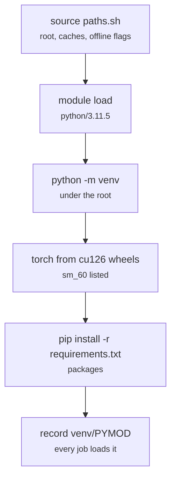

# env/paths.sh, env/setup.sh

Final pipeline · Ricky · P2 · due 2 Nov 2026 · Complete

The environment: the project root and offline flags every shell and job source, and the venv built once on the cluster's Python module.

## What it does

paths.sh exports the project root, the Hugging Face cache, the offline flags and the venv; setup.sh builds the venv on the loaded Python module, installs torch from the CUDA 12.6 wheels (the last that run on the P100), the packages and the encoder, and records the module name in venv/PYMOD so every job loads the same one. The first chain submission of 2 November had built the venv on the node's own Python 3.9 with CUDA 12.8 wheels, which dropped the P100; the rebuild on python/3.11.5 fixed it.

## Architecture

## Depends on

- `module load gcccore/13.2.0 python/3.11.5`
- `requirements.txt`

## Affects

- [slurm/_header.sh](slurm-header-sh.md)
- [slurm/chain.sh](slurm-chain-sh.md)
- [tests/unit/](tests-unit.md)
- [tests/smoke.sh](tests-smoke-sh.md)

## Reads and writes

| Reads | Writes |
|---|---|
| `requirements.txt` | `venv/` |
|  | `venv/PYMOD` |
|  | `hf_cache/` |

## Todos

- [x] Rebuild on python/3.11.5 with the CUDA 12.6 wheels; the module pair in venv/PYMOD (Ricky, 0.5 h, 2 Nov)
- [x] Data in place and the Hugging Face cache on the login node (Ricky, 1.5 h, 5 Oct)
- [x] Accounts and project membership for the team (Hara, 1.5 h, 5 Oct)
- [x] paths.sh: the project root, the offline flags, the venv (Ricky, 0.5 h, 27 Oct)

Open items live as sub-issues of the program's issue: [open it on GitHub](https://github.com/hputhireth/Technology-and-Design/issues?q=is%3Aissue+label%3Aprogram+%22env-paths-sh%22).

## Meetings

| Date | Rating | Note |
|---|---|---|
| 2 Nov 2026 | 2/5 | First chain submission on Python 3.9 with the CUDA 12.8 wheels: jobs cancelled, environment rebuilt. |

## Hours

4 h over 4 todos, 4 h done. By week: Sprint 3 0.5 h, Sprint 4 0.5 h, Before the sprints 3 h.

[Back to the backlog](../README.md) · [Pipeline map](../PIPELINE.md)
