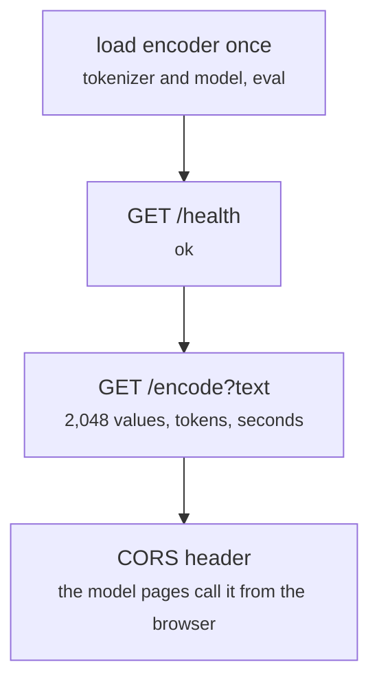

# fd_encode_server.py

Front end · Ricky · P2 · due 28 Oct 2026 · Complete

The encoder service: a local HTTP server that turns a sentence into the 2,048 values the heads were trained on.

## What it does

Loads bge-large-en-v1.5 once and serves GET /health and GET /encode?text=..., returning the [CLS] vector joined with the mean over the tokens, unnormalised, with the token count and the seconds. The application calls it for a new sentence; in the app the encoder is held in a cached resource so it loads once per process.

## Architecture

## Depends on

- [common/encoder.py](common-encoder-py.md)

## Affects

- [sentiment-app/app.py](sentiment-app-app-py.md)
- [deploy/Dockerfile](deploy-dockerfile.md)

## Reads and writes

| Reads | Writes |
|---|---|
| `hf_cache/ or the hub` | `nothing on disk` |

## Todos

- [x] HTTP service: /health and /encode, the 2,048 values as the heads were trained (Ricky, 0.5 h, 27 Oct)
- [x] Encoder optimised in the app: one load per process (Hara, 1 h, 28 Oct)

Open items live as sub-issues of the program's issue: [open it on GitHub](https://github.com/hputhireth/Technology-and-Design/issues?q=is%3Aissue+label%3Aprogram+%22fd-encode-server-py%22).

## Meetings

| Date | Rating | Note |
|---|---|---|
| 27 Oct 2026 | 4/5 | The encoder service and the lean repository shown together. |

## Hours

1.5 h over 2 todos, 1.5 h done. By week: Sprint 3 1.5 h.

[Back to the backlog](../README.md) · [Pipeline map](../PIPELINE.md)
