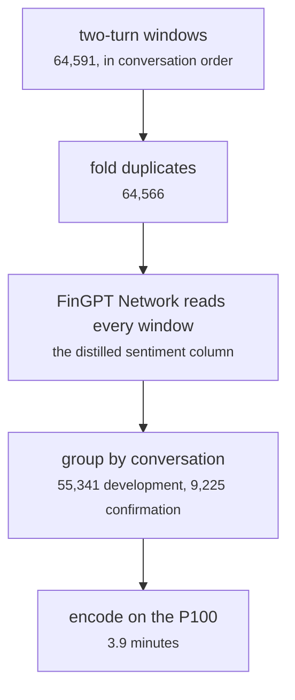

# fs_detailed/ed_01_prepare.py, ed_gpu_encode.py

Model research · Ricky · P3 · due 24 Oct 2026 · Complete

The dialogue windows: two turns in conversation order, the FinGPT Network's reading as the sentiment column, 64,566 windows encoded.

## What it does

Builds two-turn windows of EmpatheticDialogues in conversation order, keeps the speaker's emotion (32 classes) and adds the sentiment column by distillation: the FinGPT Network reads every window once (negative 3.9 percent, neutral 85.6, positive 10.5). Groups are conversations, so no split separates two windows of one conversation. The windows are encoded on the P100 in 3.9 minutes.

## Architecture

## Depends on

- [fs_detailed/fd_07_nn.py](fs-detailed-fd-07-nn-py.md)
- [models/softmax_emotion_to_sentiment.py](models-softmax-emotion-to-sentiment-py.md)

## Affects

- [fs_detailed/ed_07_nn.py](fs-detailed-ed-07-nn-py.md)
- [scripts/prepare.py](scripts-prepare-py.md)
- [scripts/encode.py](scripts-encode-py.md)

## Reads and writes

| Reads | Writes |
|---|---|
| `data/raw/empathetic_training.csv` | `data/cache/ed_<hash>/train.csv` |
| `results/fd/train/nn/nn_selected.json` | `features/<key>/pooled.npy` |

## Todos

- [x] The FinGPT Network reads every window: the distilled sentiment column (Ricky, 0.5 h, 24 Oct)
- [x] Two-turn windows in conversation order, encoded on the P100 (Ricky, 0.5 h, 24 Oct)

Open items live as sub-issues of the program's issue: [open it on GitHub](https://github.com/hputhireth/Technology-and-Design/issues?q=is%3Aissue+label%3Aprogram+%22fs-detailed-ed-01-prepare-py%22).

## Meetings

| Date | Rating | Note |
|---|---|---|
| 24 Oct 2026 | 4/5 | Sprint 3 planning: the Dialogue Network and the reinforcement suite. |

## Hours

1 h over 2 todos, 1 h done. By week: Sprint 3 1 h.

[Back to the backlog](../README.md) · [Pipeline map](../PIPELINE.md)
