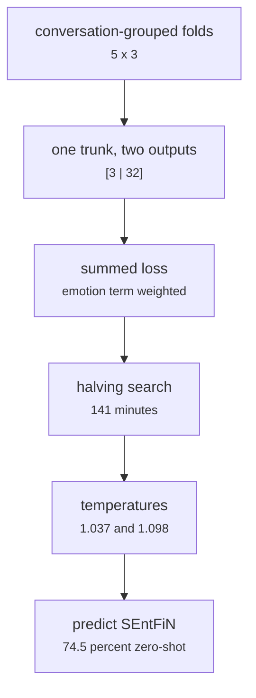

# fs_detailed/ed_07_nn.py

Model research · Ricky · P2 · due 25 Oct 2026 · Complete

The Dialogue Network search: one trunk, two outputs (sentiment and 32 emotions). Job of Sunday 25 October, 141 minutes; c31 chosen.

## What it does

The same protocol as fd_07 with two readings from one trunk: the loss is the sum of the two readings' cross-entropies with the emotion term weighted, the folds are grouped by conversation, and one temperature is fitted per reading. c31 came out: 2,048 to 256 ReLU to 128 SiLU to 32 ELU to [3 | 32], 562,723 weights, 0.8555 sentiment and 0.3723 emotion macro-F1 cross-validated, 74.5 percent on SEntFiN without ever seeing a finance label.

## Architecture

## Depends on

- [fs_detailed/ed_01_prepare.py](fs-detailed-ed-01-prepare-py.md)
- [fs_detailed/fd_07_nn.py](fs-detailed-fd-07-nn-py.md)

## Affects

- [fs_detailed/ed_12_rl.py](fs-detailed-ed-12-rl-py.md)
- [common/head.py](common-head-py.md)
- [scripts/train.py](scripts-train-py.md)

## Reads and writes

| Reads | Writes |
|---|---|
| `features/<key>/pooled.npy` | `results/ed/train/nn/nn_selected.json` |
| `data/cache/ed_<hash>/train.csv` | `nn_folds.csv` |
|  | `nn_confirmation.json` |

## Todos

- [x] The search job of Sun 25 Oct; c31 chosen (Ricky, 0.5 h, 25 Oct)
- [x] Two-output head from one trunk; conversation-grouped splits (Ricky, 1 h, 23 Oct)
- [x] Prediction on SEntFiN: 74.5 percent without a finance label (Ricky, 0.5 h, 25 Oct)
- [x] Review at the live-testing session of Sprint 3 (Johnny, 2 h, 26 Oct)

Open items live as sub-issues of the program's issue: [open it on GitHub](https://github.com/hputhireth/Technology-and-Design/issues?q=is%3Aissue+label%3Aprogram+%22fs-detailed-ed-07-nn-py%22).

## Meetings

| Date | Rating | Note |
|---|---|---|
| 25 Oct 2026 | 4/5 | The Dialogue Network reviewed on the Sunday call. |
| 26 Oct 2026 | 4/5 | Live-testing check: the two readings from one trunk. |

## Hours

4 h over 4 todos, 4 h done. By week: Sprint 2 1 h, Sprint 3 3 h.

[Back to the backlog](../README.md) · [Pipeline map](../PIPELINE.md)
