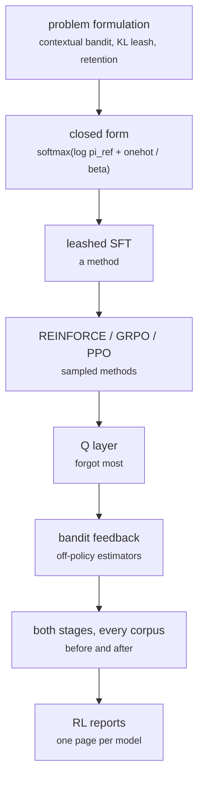

# fs_detailed/ed_12_rl.py

Model research · Ricky · P2 · due 26 Oct 2026 · Complete

The reinforcement suite: the closed form, leashed SFT, REINFORCE, GRPO, PPO and a Q layer, full-information and bandit feedback, 36 runs.

## What it does

Formulates adaptation as a contextual bandit under a KL leash with a retention term, then runs every method on every corpus, before and after: the closed form of the leashed objective, leashed supervised fine-tuning, REINFORCE, GRPO, PPO with the ratio clipped to [0.8, 1.2], a Q layer, and the bandit variants with the off-policy estimators on the log. The job of 25 October 15:47 ran 22 adaptation runs in 9 minutes 19 seconds. REINFORCE, PPO and the Q layer tied with GRPO or fell behind it when every label is known, so only the closed form and GRPO went into the final repository.

## Architecture

## Depends on

- [fs_detailed/ed_07_nn.py](fs-detailed-ed-07-nn-py.md)
- [fs_detailed/fd_07_nn.py](fs-detailed-fd-07-nn-py.md)
- [fs_detailed/fd_transfer_prior.py](fs-detailed-fd-transfer-prior-py.md)

## Affects

- [fs_detailed/ed_rl_mistakes.py](fs-detailed-ed-rl-mistakes-py.md)
- [scripts/adapt.py](scripts-adapt-py.md)

## Reads and writes

| Reads | Writes |
|---|---|
| `results/fd/train/nn/*.json` | `results/ed/rl/<method>/summary.json` |
| `results/ed/train/nn/*.json` | `adapt_log.csv` |
| `features` |  |

## Todos

- [x] Problem formulation: contextual bandit, KL leash, retention term (Ricky, 1 h, 22 Oct)
- [x] The closed form of the leashed objective (Ricky, 0.5 h, 25 Oct)
- [x] REINFORCE, GRPO and PPO with the clipped ratio (Ricky, 1 h, 25 Oct)
- [x] Both stages on every corpus, before and after; the RL reports (Ricky, 0.5 h, 26 Oct)
- [x] The Q layer and the bandit variants with the off-policy estimators (Ricky, 0.5 h, 26 Oct)
- [x] Review of gains and retention at the sprint review (Johnny, 1 h, 26 Oct)
- [ ] ~~Ship REINFORCE, PPO and the Q layer in the final repository~~ (Ricky, 0 h, 28 Oct), cancelled
- [ ] ~~Advantage scaled by the whole batch's standard deviation~~ (Ricky, 0 h, 29 Oct), cancelled

Open items live as sub-issues of the program's issue: [open it on GitHub](https://github.com/hputhireth/Technology-and-Design/issues?q=is%3Aissue+label%3Aprogram+%22fs-detailed-ed-12-rl-py%22).

## Meetings

| Date | Rating | Note |
|---|---|---|
| 26 Oct 2026 | 4/5 | Gains and retention reviewed method by method. |
| 30 Oct 2026 | 4/5 | Sprint 3 review: only the closed form and GRPO ship. |

## Hours

4.5 h over 8 todos, 4.5 h done. By week: Sprint 2 1 h, Sprint 3 3.5 h.

[Back to the backlog](../README.md) · [Pipeline map](../PIPELINE.md)
