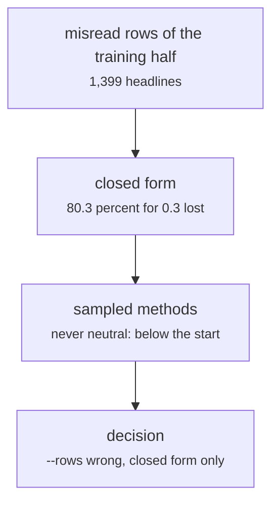

# fs_detailed/ed_rl_mistakes.py

Model research · Ricky · P4 · due 27 Oct 2026 · Complete

The misread rows only: the selection-bias experiment. The closed form gains 6.8 points for 0.3 lost; every sampled method learned never neutral.

## What it does

Trains only on the rows of the training half that the starting head misreads. The closed form reaches 80.3 percent on the held-out half for 0.3 FinGPT points lost. The sampled methods on the same rows all learned to avoid neutral and ended below where they started: a biased sample, so the setting ships for the closed form only, as --rows wrong of adapt.py.

## Architecture

## Depends on

- [fs_detailed/ed_12_rl.py](fs-detailed-ed-12-rl-py.md)

## Affects

- [scripts/adapt.py](scripts-adapt-py.md)

## Reads and writes

| Reads | Writes |
|---|---|
| `results/fd/train/nn/*.json` | `results/ed/rl_mistakes/summary.json` |
| `features of SEntFiN` |  |

## Todos

- [x] The closed form on the 1,399 misread headlines (Ricky, 0.5 h, 26 Oct)
- [ ] ~~Sampled methods on the misread rows~~ (Ricky, 0.5 h, 27 Oct), cancelled

Open items live as sub-issues of the program's issue: [open it on GitHub](https://github.com/hputhireth/Technology-and-Design/issues?q=is%3Aissue+label%3Aprogram+%22fs-detailed-ed-rl-mistakes-py%22).

## Meetings

| Date | Rating | Note |
|---|---|---|
| 27 Oct 2026 | 3/5 | A biased sample for the sampled methods; kept for the closed form only. |

## Hours

1 h over 2 todos, 0.5 h done. By week: Sprint 3 1 h.

[Back to the backlog](../README.md) · [Pipeline map](../PIPELINE.md)
