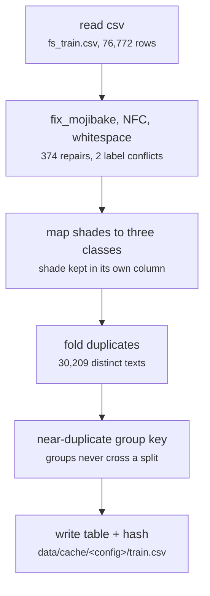

# fs_detailed/fd_01_prepare.py

Encoding research · Ricky · P3 · due 6 Oct 2026 · Complete

The research pipeline's preparation of FinGPT: cleaning, the nine shades to three classes, duplicates folded, a group key.

## What it does

Reads data/raw/fs_train.csv, repairs the Windows-1252 mojibake, applies NFC, strips zero-width characters and normalises whitespace while keeping punctuation. Maps the nine sentiment shades to negative, neutral and positive and keeps the shade in its own column. Folds exact duplicates into one row with a count and gives every row a near-duplicate group so that no split ever separates two versions of the same sentence. Writes one table per set with a content hash.

## Architecture

## Depends on

- `data/raw/fs_train.csv`
- `scripts in the research pipeline share one config file`

## Affects

- [fs_detailed/fd_gpu_encode.py](fs-detailed-fd-gpu-encode-py.md)
- [fs_detailed/fd_linear.py](fs-detailed-fd-linear-py.md)
- [fs_detailed/fd_07_nn.py](fs-detailed-fd-07-nn-py.md)
- [scripts/prepare.py](scripts-prepare-py.md)

## Reads and writes

| Reads | Writes |
|---|---|
| `data/raw/fs_train.csv` | `data/cache/fd_<hash>/train.csv` |
|  | `manifest.json` |
|  | `label_counts.json` |

## Todos

- [x] Clean FinGPT: mojibake repair, NFC, whitespace; the nine shades to three classes (Ricky, 1.5 h, 5 Oct)
- [x] Fold exact duplicates and build the near-duplicate group key (Ricky, 1 h, 6 Oct)

Open items live as sub-issues of the program's issue: [open it on GitHub](https://github.com/hputhireth/Technology-and-Design/issues?q=is%3Aissue+label%3Aprogram+%22fs-detailed-fd-01-prepare-py%22).

## Meetings

| Date | Rating | Note |
|---|---|---|
| 6 Oct 2026 | 3/5 | Prepared tables walked through on the call: 374 mojibake repairs and 2 label conflicts shown. |

## Hours

2.5 h over 2 todos, 2.5 h done. By week: Before the sprints 2.5 h.

[Back to the backlog](../README.md) · [Pipeline map](../PIPELINE.md)
