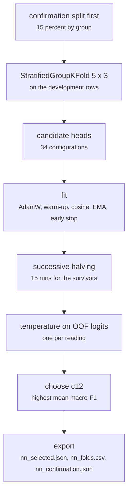

# fs_detailed/fd_07_nn.py

Model research · Ricky · P2 · due 19 Oct 2026 · Complete

The head search on FinGPT under the protocol: 34 configurations, successive halving, 15 runs each. The first network memorised; c12 came out.

## What it does

Stage one of the research pipeline for the network heads. The first feed-forward head on the cached features memorised its training set: training accuracy kept climbing while held-out accuracy fell. The paper study that followed set the protocol: a confirmation split held out by group before anything is fitted, StratifiedGroupKFold five by three seeds, label smoothing, an exponential moving average of the weights, early stopping on the validation cross-entropy, a temperature fitted on the out-of-fold logits. The search ran as the job of Monday 19 October (59 minutes) and chose c12: 2,048 to 256 leaky ReLU to 128 tanh to 3, 557,827 weights, 0.8044 macro-F1 cross-validated, 0.798 on the confirmation split.

## Architecture

## Depends on

- [fs_detailed/fd_01_prepare.py](fs-detailed-fd-01-prepare-py.md)
- [fs_detailed/fd_gpu_encode.py](fs-detailed-fd-gpu-encode-py.md)
- [fs_detailed/fd_investigate.py](fs-detailed-fd-investigate-py.md)

## Affects

- [fs_detailed/fd_08_label_audit.py](fs-detailed-fd-08-label-audit-py.md)
- [fs_detailed/fd_10_nn_inspect.py](fs-detailed-fd-10-nn-inspect-py.md)
- [fs_detailed/fd_transfer_prior.py](fs-detailed-fd-transfer-prior-py.md)
- [fs_detailed/ed_01_prepare.py](fs-detailed-ed-01-prepare-py.md)
- [common/head.py](common-head-py.md)
- [scripts/train.py](scripts-train-py.md)
- [data/benedetti_check.py](data-benedetti-check-py.md)

## Reads and writes

| Reads | Writes |
|---|---|
| `features/<key>/pooled.npy` | `results/fd/train/nn/nn_selected.json` |
| `data/cache/fd_<hash>/train.csv` | `nn_folds.csv` |
|  | `nn_confirmation.json` |
|  | `inside_summary.json` |

## Todos

- [x] Memorisation found: training accuracy climbs while held-out falls (Ricky, 2 h, 13 Oct)
- [x] Paper study on noisy labels and memorisation; the protocol written down (Ricky, 5 h, 15 Oct)
- [x] StratifiedGroupKFold 5 x 3, label smoothing, EMA, early stopping (Ricky, 3 h, 17 Oct)
- [x] Successive halving over 34 configurations; the job of Mon 19 Oct (Ricky, 2.5 h, 19 Oct)
- [x] First feed-forward head on the cached features (Ricky, 4 h, 11 Oct)
- [x] Grouped folds by the near-duplicate key (Ricky, 2 h, 14 Oct)
- [x] Training loop with the confirmation split held out first (Ricky, 2 h, 16 Oct)
- [x] Temperature on the out-of-fold logits; c12 chosen at 0.8044 (Ricky, 1.5 h, 20 Oct)
- [x] Reviewer at the live-testing checks of Sprint 1: the first network run in front of the team (Johnny, 3 h, 14 Oct)

Open items live as sub-issues of the program's issue: [open it on GitHub](https://github.com/hputhireth/Technology-and-Design/issues?q=is%3Aissue+label%3Aprogram+%22fs-detailed-fd-07-nn-py%22).

## Meetings

| Date | Rating | Note |
|---|---|---|
| 13 Oct 2026 | 2/5 | The first network memorises its training set. |
| 16 Oct 2026 | 3/5 | Sprint 1 review: the protocol taken from the papers, page by page. |
| 20 Oct 2026 | 5/5 | c12 at 0.8044 cross-validated and 0.798 on the confirmation split. |

## Hours

25 h over 9 todos, 25 h done. By week: Sprint 1 18 h, Sprint 2 7 h.

[Back to the backlog](../README.md) · [Pipeline map](../PIPELINE.md)
