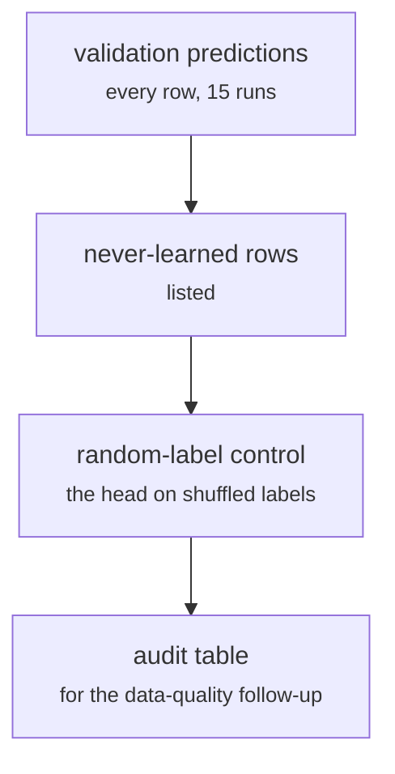

# fs_detailed/fd_08_label_audit.py

Model research · Ricky · P3 · due 22 Oct 2026 · Complete

The label audit and the random-label control: every validation row's predicted class recorded, the head on shuffled labels.

## What it does

Records the predicted class of every validation row across the 15 runs so the rows the head never learns can be read, and trains the same head on shuffled labels to show how much of the training accuracy is memorisation. Johnny's data-quality follow-up on the audited rows named the convention gap between the annotators.

## Architecture

## Depends on

- [fs_detailed/fd_07_nn.py](fs-detailed-fd-07-nn-py.md)
- [data/explore_general.py](data-explore-general-py.md)

## Affects

- [fs_detailed/fd_transfer_prior.py](fs-detailed-fd-transfer-prior-py.md)
- `the data section of the design document`

## Reads and writes

| Reads | Writes |
|---|---|
| `results/fd/train/nn/nn_folds.csv` | `results/fd/audit/*.csv` |

## Todos

- [x] Every validation row's predicted class recorded for the audit (Ricky, 1 h, 20 Oct)
- [x] Random-label control: the head on shuffled labels (Ricky, 1.5 h, 21 Oct)
- [x] Data-quality follow-up on the audited rows (Johnny, 2.5 h, 21 Oct)

Open items live as sub-issues of the program's issue: [open it on GitHub](https://github.com/hputhireth/Technology-and-Design/issues?q=is%3Aissue+label%3Aprogram+%22fs-detailed-fd-08-label-audit-py%22).

## Meetings

| Date | Rating | Note |
|---|---|---|
| 21 Oct 2026 | 4/5 | Audit reviewed; the convention gap named. |

## Hours

5 h over 3 todos, 5 h done. By week: Sprint 2 5 h.

[Back to the backlog](../README.md) · [Pipeline map](../PIPELINE.md)
