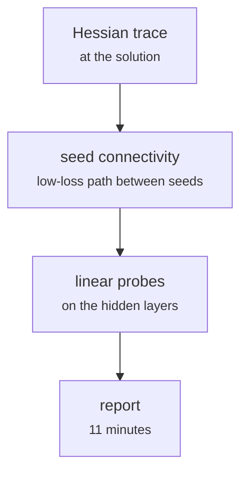

# fs_detailed/fd_10_nn_inspect.py

Model research · Ricky · P3 · due 23 Oct 2026 · Complete

The inspection of the chosen head: Hessian trace, seed connectivity, linear probes. Eleven minutes.

## What it does

What replaced the representation analysis of Assignment 2. With the encoder frozen the space does not change, so the head is examined: the trace of the Hessian at the solution, whether the solutions of different seeds connect along a low-loss path, and what linear probes read from each hidden layer.

## Architecture

## Depends on

- [fs_detailed/fd_07_nn.py](fs-detailed-fd-07-nn-py.md)
- [research/representation_analysis.py](research-representation-analysis-py.md)

## Affects

- `the analysis section of the design document`

## Reads and writes

| Reads | Writes |
|---|---|
| `results/fd/train/nn/nn_selected.json` | `results/fd/inspect/*.json` |
| `features` |  |

## Todos

- [x] Hessian trace and seed connectivity of c12 (Ricky, 1.5 h, 22 Oct)
- [x] Linear probes on the hidden layers (Ricky, 1 h, 22 Oct)

Open items live as sub-issues of the program's issue: [open it on GitHub](https://github.com/hputhireth/Technology-and-Design/issues?q=is%3Aissue+label%3Aprogram+%22fs-detailed-fd-10-nn-inspect-py%22).

## Meetings

| Date | Rating | Note |
|---|---|---|
| 23 Oct 2026 | 4/5 | Sprint 2 review: the full model research demonstrated. |

## Hours

2.5 h over 2 todos, 2.5 h done. By week: Sprint 2 2.5 h.

[Back to the backlog](../README.md) · [Pipeline map](../PIPELINE.md)
