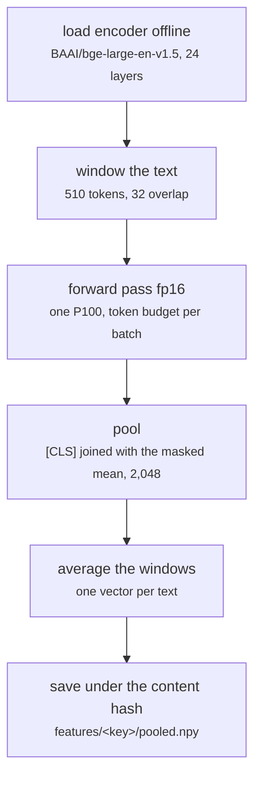

# fs_detailed/fd_gpu_encode.py

Encoding research · Ricky · P3 · due 6 Oct 2026 · Complete

The first encoding pass: bge-large-en-v1.5 frozen, fp16 on one P100, 2,048 values per text, cached under a content hash.

## What it does

Loads the encoder offline from the Hugging Face cache, reads every prepared text in windows of 510 tokens with a 32-token overlap, pools the [CLS] vector joined with the masked mean over the tokens, averages the windows of a long text and stores the result as float16 under the SHA-256 of the weights, the tokenizer, the text column, the pooling and the length settings. A second run with the same inputs finds the cache and does nothing. 30,209 texts took 1.8 minutes.

## Architecture

## Depends on

- [fs_detailed/fd_01_prepare.py](fs-detailed-fd-01-prepare-py.md)
- `hf_cache/ with the encoder weights`

## Affects

- [fs_detailed/fd_linear.py](fs-detailed-fd-linear-py.md)
- [fs_detailed/fd_07_nn.py](fs-detailed-fd-07-nn-py.md)
- [scripts/encode.py](scripts-encode-py.md)

## Reads and writes

| Reads | Writes |
|---|---|
| `data/cache/<config>/*.csv` | `features/<key>/pooled.npy` |
| `hf_cache/` | `ids.csv` |
|  | `manifest.json` |

## Todos

- [x] First encoding job on one P100 in fp16: 30,209 texts in 1.8 min (Ricky, 1.5 h, 5 Oct)
- [x] Cache under the content hash of weights, tokenizer, text, pooling and length (Ricky, 1.5 h, 6 Oct)

Open items live as sub-issues of the program's issue: [open it on GitHub](https://github.com/hputhireth/Technology-and-Design/issues?q=is%3Aissue+label%3Aprogram+%22fs-detailed-fd-gpu-encode-py%22).

## Meetings

| Date | Rating | Note |
|---|---|---|
| 6 Oct 2026 | 4/5 | Encoding time far under the A2 estimate: 1.8 minutes for the whole corpus. |

## Hours

3 h over 2 todos, 3 h done. By week: Before the sprints 3 h.

[Back to the backlog](../README.md) · [Pipeline map](../PIPELINE.md)
