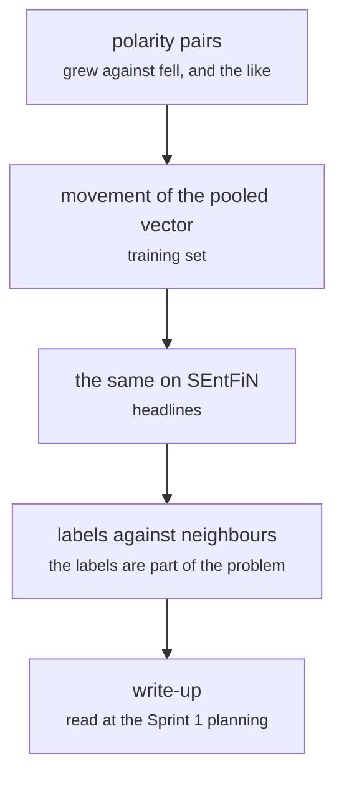

# fs_detailed/fd_investigate.py

Encoding research · Ricky · P4 · due 10 Oct 2026 · Complete

The data investigation of 7 to 10 October: how the encoder's position moves when a sentence changes polarity.

## What it does

Takes pairs of sentences that differ in polarity and measures how far the pooled vector moves, on the training set and on the SEntFiN headlines, and compares the training labels with the encoder's nearest neighbours. It showed that the information is there but a single linear boundary does not read it, and that the training labels themselves were part of the problem. Its write-up opened Sprint 1.

## Architecture

## Depends on

- [fs_detailed/fd_linear.py](fs-detailed-fd-linear-py.md)
- [fs_detailed/fd_gpu_encode.py](fs-detailed-fd-gpu-encode-py.md)

## Affects

- [fs_detailed/fd_07_nn.py](fs-detailed-fd-07-nn-py.md)
- [fs_detailed/fd_08_label_audit.py](fs-detailed-fd-08-label-audit-py.md)

## Reads and writes

| Reads | Writes |
|---|---|
| `features/<key>/pooled.npy` | `shared notes: the investigation read-out` |
| `data/cache/<config>/*.csv` |  |

## Todos

- [x] Polarity flips: how the pooled vector moves when a sentence changes polarity (Ricky, 2.5 h, 7 Oct)
- [x] The same on the SEntFiN headlines (Ricky, 1.5 h, 8 Oct)
- [x] Training labels against the encoder's neighbours (Ricky, 2 h, 9 Oct)
- [x] Write-up for the Sprint 1 planning (Ricky, 1 h, 10 Oct)

Open items live as sub-issues of the program's issue: [open it on GitHub](https://github.com/hputhireth/Technology-and-Design/issues?q=is%3Aissue+label%3Aprogram+%22fs-detailed-fd-investigate-py%22).

## Meetings

| Date | Rating | Note |
|---|---|---|
| 9 Oct 2026 | 3/5 | The information is there; a single linear boundary does not read it. |
| 10 Oct 2026 | 4/5 | Sprint 1 planned on the strength of the read-out: a deep learning pipeline. |

## Hours

7 h over 4 todos, 7 h done. By week: Sprint 1 1 h, Before the sprints 6 h.

[Back to the backlog](../README.md) · [Pipeline map](../PIPELINE.md)
