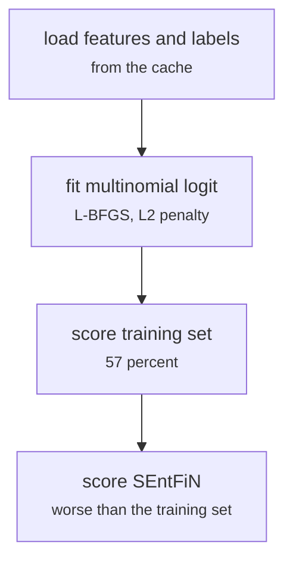

# fs_detailed/fd_linear.py

Encoding research · Ricky · P4 · due 6 Oct 2026 · Complete

The first model on the SuperComputer: a multinomial logit on the frozen features. 57 percent on our own training set.

## What it does

Fits a multinomial logistic regression on the cached 2,048 features and scores it on the training set and on SEntFiN. The 57 percent on our own training rows, and worse on the test, is the result that started the four-day investigation and the paper study. The script stayed in the research pipeline as the ancestor of the linear control.

## Architecture

## Depends on

- [fs_detailed/fd_gpu_encode.py](fs-detailed-fd-gpu-encode-py.md)

## Affects

- [fs_detailed/fd_investigate.py](fs-detailed-fd-investigate-py.md)
- [scripts/linear.py](scripts-linear-py.md)

## Reads and writes

| Reads | Writes |
|---|---|
| `features/<key>/pooled.npy` | `results/fd/linear_first/summary.json` |
| `data/cache/<config>/train.csv` |  |

## Todos

- [x] Fit the multinomial logit on the cached features (Ricky, 1.5 h, 6 Oct)
- [x] Score on the training set and on SEntFiN (Ricky, 1 h, 6 Oct)

Open items live as sub-issues of the program's issue: [open it on GitHub](https://github.com/hputhireth/Technology-and-Design/issues?q=is%3Aissue+label%3Aprogram+%22fs-detailed-fd-linear-py%22).

## Meetings

| Date | Rating | Note |
|---|---|---|
| 6 Oct 2026 | 2/5 | 57 percent on our own training set, worse on the test; the investigation agreed on the spot. |

## Hours

2.5 h over 2 todos, 2.5 h done. By week: Before the sprints 2.5 h.

[Back to the backlog](../README.md) · [Pipeline map](../PIPELINE.md)
