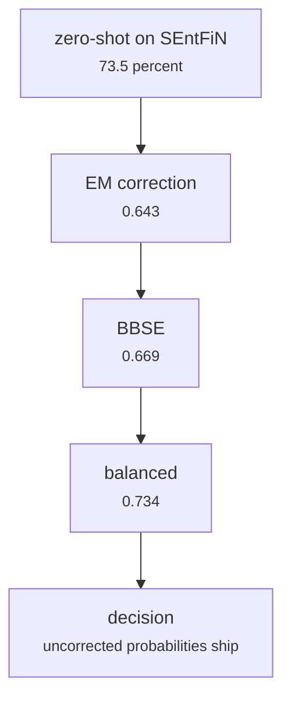

# fs_detailed/fd_transfer_prior.py

Model research · Ricky · P3 · due 23 Oct 2026 · Complete

Zero-shot transfer to SEntFiN and the prior corrections: EM, BBSE and balanced all lost to the uncorrected probabilities.

## What it does

Scores the FinGPT Network on the 10,532 labelled SEntFiN headlines without any adaptation (73.5 percent) and applies the three prior corrections proposed in Assignment 2. They reach 0.643, 0.669 and 0.734 against 0.735 uncorrected: the SEntFiN errors are a convention shift, not a change of class mix, so no prior correction repairs them and none ships.

## Architecture

## Depends on

- [fs_detailed/fd_07_nn.py](fs-detailed-fd-07-nn-py.md)

## Affects

- [scripts/predict.py](scripts-predict-py.md)
- [fs_detailed/ed_12_rl.py](fs-detailed-ed-12-rl-py.md)

## Reads and writes

| Reads | Writes |
|---|---|
| `results/fd/train/nn/nn_selected.json` | `results/fd/sentfin/*.json` |
| `features of SEntFiN` |  |

## Todos

- [x] Zero-shot on SEntFiN: 73.5 percent (Ricky, 1 h, 20 Oct)
- [x] EM, BBSE and balanced corrections against the uncorrected reading (Ricky, 1.5 h, 22 Oct)
- [ ] ~~Ship a prior correction in the application~~ (Ricky, 0 h, 23 Oct), cancelled

Open items live as sub-issues of the program's issue: [open it on GitHub](https://github.com/hputhireth/Technology-and-Design/issues?q=is%3Aissue+label%3Aprogram+%22fs-detailed-fd-transfer-prior-py%22).

## Meetings

| Date | Rating | Note |
|---|---|---|
| 23 Oct 2026 | 3/5 | Uncorrected probabilities kept; the errors are a convention shift. |

## Hours

2.5 h over 3 todos, 2.5 h done. By week: Sprint 2 2.5 h.

[Back to the backlog](../README.md) · [Pipeline map](../PIPELINE.md)
