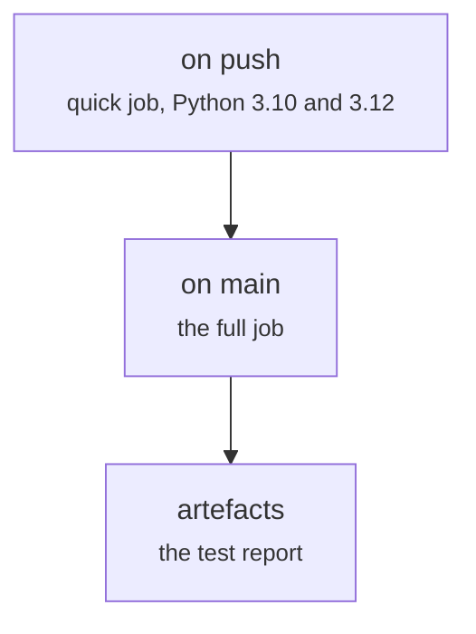

# .github/workflows/ci.yml (application)

Front end · Hara · P2 · due 1 Nov 2026 · Complete

The application's CI: the quick job on every push on Python 3.10 and 3.12, the full job on main.

## What it does

The quick job installs the application and runs the component tests on two Python versions on every push; the full job on main adds the AppTest scenarios, the non-functional checks, the parity tests and the load test.

## Architecture

## Depends on

- [sentiment-app/tests/](sentiment-app-tests.md)

## Affects

- [sentiment-app/README.md and the deployment](sentiment-app-readme-md-and-the-deployment.md)

## Reads and writes

| Reads | Writes |
|---|---|
| `nothing on disk` | `nothing on disk` |

## Todos

- [x] Quick job on every push on Python 3.10 and 3.12 (Hara, 1 h, 31 Oct)
- [x] Full job on main (Hara, 0.5 h, 1 Nov)

Open items live as sub-issues of the program's issue: [open it on GitHub](https://github.com/hputhireth/Technology-and-Design/issues?q=is%3Aissue+label%3Aprogram+%22github-workflows-ci-yml%22).

## Meetings

| Date | Rating | Note |
|---|---|---|
| 1 Nov 2026 | 4/5 | CI green on the redeployment commit. |

## Hours

1.5 h over 2 todos, 1.5 h done. By week: Sprint 4 1.5 h.

[Back to the backlog](../README.md) · [Pipeline map](../PIPELINE.md)
