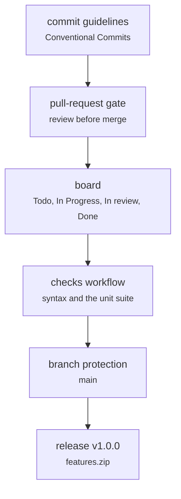

# .github/ (templates, the checks workflow, branch protection, the board)

Documents and process · Ricky · P2 · due 11 Nov 2026 · In progress

The repository protocol: agile commit guidelines, the pull-request gate, the GitHub Projects board sentiment_heads, branch protection on main.

## What it does

Johnny's commit guidelines and the pull-request gate from Sprint 1; the public repository's final update pushed to main on 4 November; the GitHub Projects board with the four columns; the full cycle (issues, branches, pull requests with the checks workflow, review, squash merge) and branch protection still to run, with the release v1.0.0 carrying features.zip.

## Architecture

## Depends on

- [docs/minutes/](docs-minutes.md)

## Affects

- [docs/A3_Design_Document.docx](docs-a3-design-document-docx.md)

## Reads and writes

| Reads | Writes |
|---|---|
| `nothing on disk` | `.github/` |
|  | `the board` |
|  | `the release` |

## Todos

- [x] Agile commit guidelines and the pull-request gate (Johnny, 1.5 h, 12 Oct)
- [x] GitHub Projects board sentiment_heads with the four columns (Ricky, 0.5 h, 4 Nov)
- [ ] Final update pushed to main; the protocol cycle still to run (Ricky, 1 h, 5 Nov), in progress
- [ ] Branch protection on main; the release v1.0.0 with features.zip (Ricky, 1 h, 7 Nov), todo
- [ ] ~~Set up a Miro board for the kanban~~ (Johnny, 0.5 h, 4 Nov), cancelled

Open items live as sub-issues of the program's issue: [open it on GitHub](https://github.com/hputhireth/Technology-and-Design/issues?q=is%3Aissue+label%3Aprogram+%22github%22).

## Meetings

| Date | Rating | Note |
|---|---|---|
| 4 Nov 2026 | 3/5 | Board created; the final update went to main directly instead of through the cycle. |

## Hours

4.5 h over 5 todos, 2 h done. By week: Sprint 1 1.5 h, Sprint 4 2 h, Final week 1 h.

[Back to the backlog](../README.md) · [Pipeline map](../PIPELINE.md)
