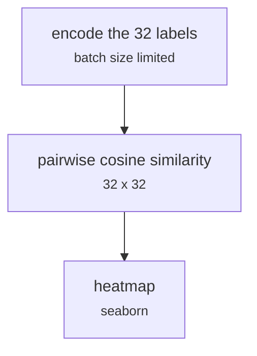

# models/emotion_label_similarity.py

Encoding research · Johnny · P5 · due 8 Oct 2026 · Cancelled

Pairwise similarity of the 32 encoded emotion labels, drawn as a heatmap. Dropped: the intensity pairs sit on top of each other.

> Dropped on 9 October.

## What it does

Encodes the 32 emotion label names with the encoder, computes their pairwise cosine similarity and draws it with seaborn, with a batch size limit added to the encoding. The heatmap showed that afraid and terrified, angry and furious, sad and devastated are indistinguishable to the encoder, which is one reason the valence route was dropped.

## Architecture

## Depends on

- [data/explore_general.py](data-explore-general-py.md)
- [fs_detailed/fd_gpu_encode.py](fs-detailed-fd-gpu-encode-py.md)

## Affects

- [models/softmax_emotion_to_sentiment.py](models-softmax-emotion-to-sentiment-py.md)

## Reads and writes

| Reads | Writes |
|---|---|
| `the 32 emotion names` | `similarity heatmap` |

## Todos

- [x] Encode the 32 emotion labels and compute the pairwise similarity (Johnny, 1.5 h, 8 Oct)
- [x] Heatmap with seaborn; a batch size limit during encoding (Johnny, 0.5 h, 8 Oct)

Open items live as sub-issues of the program's issue: [open it on GitHub](https://github.com/hputhireth/Technology-and-Design/issues?q=is%3Aissue+label%3Aprogram+%22models-emotion-label-similarity-py%22).

## Meetings

| Date | Rating | Note |
|---|---|---|
| 9 Oct 2026 | 2/5 | The intensity pairs sit on top of each other; the route was dropped. |

## Hours

2 h over 2 todos, 2 h done. By week: Before the sprints 2 h.

[Back to the backlog](../README.md) · [Pipeline map](../PIPELINE.md)
