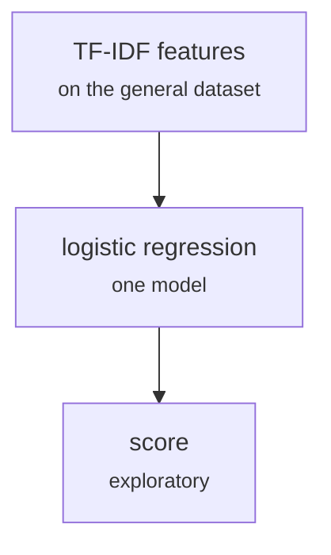

# models/general_tfidf_logreg.py

Encoding research · Johnny · P5 · due 5 Oct 2026 · Cancelled

A logistic regression on TF-IDF features for the general domain. Explored, then walked back.

> Walked back on 10 October: the word logit of the final repository is the bag-of-words control.

## What it does

Johnny's experimental general-domain model: TF-IDF features and a logistic regression on the general dataset. It was built to explore, not to deliver, and was dropped once the frozen-encoder route was chosen. Its role as a bag-of-words control passed to the word logit of the final repository, on the finance corpora.

## Architecture

## Depends on

- [data/explore_general.py](data-explore-general-py.md)

## Affects

- [scripts/words.py](scripts-words-py.md)

## Reads and writes

| Reads | Writes |
|---|---|
| `emotion-emotion_69k.csv` | `none kept` |

## Todos

- [x] TF-IDF features and a logistic regression on the general dataset (Johnny, 2 h, 5 Oct)
- [ ] ~~Compare against the frozen-encoder route~~ (Johnny, 0.5 h, 8 Oct), cancelled

Open items live as sub-issues of the program's issue: [open it on GitHub](https://github.com/hputhireth/Technology-and-Design/issues?q=is%3Aissue+label%3Aprogram+%22models-general-tfidf-logreg-py%22).

## Meetings

| Date | Rating | Note |
|---|---|---|
| 6 Oct 2026 | 3/5 | Explored only; not for the delivery. |

## Hours

2.5 h over 2 todos, 2 h done. By week: Before the sprints 2.5 h.

[Back to the backlog](../README.md) · [Pipeline map](../PIPELINE.md)
