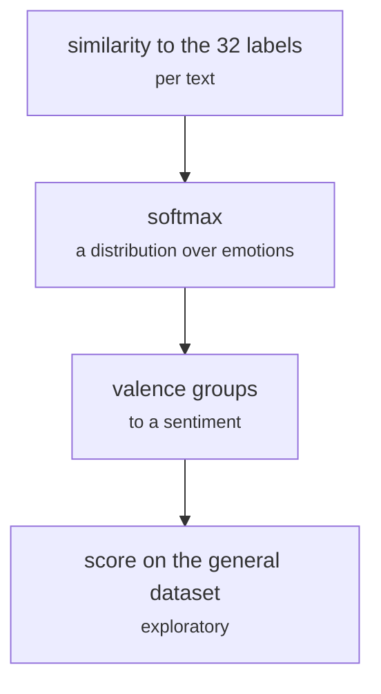

# models/softmax_emotion_to_sentiment.py

Encoding research · Johnny · P5 · due 8 Oct 2026 · Cancelled

A softmax over the encoded emotion labels to derive a sentiment: the A2 valence idea. Replaced by distillation.

> Replaced on 18 October by the distilled sentiment column of the dialogue windows.

## What it does

The Assignment 2 plan read sentiment off an emotion head through Warriner's valence groups. This script tried the first step on the general dataset: a softmax over the similarities of a text to the encoded emotion labels, mapped to a sentiment. It was replaced by distillation: the FinGPT Network reads every dialogue window once and its readings become the sentiment column the Dialogue Network learns.

## Architecture

## Depends on

- [models/emotion_label_similarity.py](models-emotion-label-similarity-py.md)

## Affects

- [fs_detailed/ed_01_prepare.py](fs-detailed-ed-01-prepare-py.md)

## Reads and writes

| Reads | Writes |
|---|---|
| `emotion-emotion_69k.csv` | `none kept` |
| `the encoded labels` |  |

## Todos

- [x] Softmax over the label similarities to derive a sentiment (Johnny, 1.5 h, 8 Oct)
- [x] Try it on the general dataset (Johnny, 1 h, 8 Oct)
- [ ] ~~Carry the valence decoding into the dialogue head~~ (Johnny, 0.5 h, 18 Oct), cancelled

Open items live as sub-issues of the program's issue: [open it on GitHub](https://github.com/hputhireth/Technology-and-Design/issues?q=is%3Aissue+label%3Aprogram+%22models-softmax-emotion-to-sentiment-py%22).

## Meetings

| Date | Rating | Note |
|---|---|---|
| 18 Oct 2026 | 2/5 | Walked back; the dialogue head gets a learned sentiment output instead. |

## Hours

3 h over 3 todos, 2.5 h done. By week: Sprint 2 0.5 h, Before the sprints 2.5 h.

[Back to the backlog](../README.md) · [Pipeline map](../PIPELINE.md)
