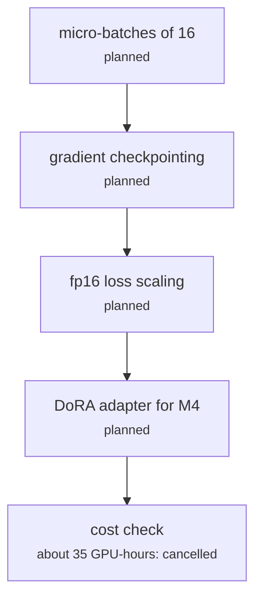

# research/finetune_encoder.py

Encoding research · Ricky · P5 · due 5 Oct 2026 · Cancelled

The Assignment 2 plan: full fine-tuning of the 335M encoder for M1 to M3 and a DoRA adapter for M4. Never written.

> Cancelled before the sprints: the encoder is frozen throughout.

## What it does

Assignment 2 proposed letting the sentiment gradient reach the attention and feed-forward matrices, with micro-batches of 16, gradient checkpointing and fp16 loss scaling on the P100, about 35 GPU-hours. The cost check of 29 and 30 September and the frozen-feature literature (Kumar et al. 2022) decided against it, Dr Vo agreed the scope cut by email, and the encoder stayed frozen.

## Architecture

## Depends on

- `the P100: 12 GB, fp16 only, no tensor cores`

## Affects

- [fs_detailed/fd_gpu_encode.py](fs-detailed-fd-gpu-encode-py.md)
- [research/representation_analysis.py](research-representation-analysis-py.md)

## Reads and writes

| Reads | Writes |
|---|---|
| `nothing on disk` | `nothing on disk` |

## Todos

- [x] Record the scope cut in the shared notes and the A2 revision (Ricky, 0.5 h, 5 Oct)
- [ ] ~~Micro-batches of 16 with gradient checkpointing and fp16 loss scaling~~ (Ricky, 0 h, 5 Oct), cancelled
- [ ] ~~DoRA adapter for M4~~ (Ricky, 0 h, 5 Oct), cancelled

Open items live as sub-issues of the program's issue: [open it on GitHub](https://github.com/hputhireth/Technology-and-Design/issues?q=is%3Aissue+label%3Aprogram+%22research-finetune-encoder-py%22).

## Meetings

| Date | Rating | Note |
|---|---|---|
| 5 Oct 2026 | 4/5 | Scope cut confirmed with Dr Vo by email; access under his project. |

## Hours

0.5 h over 3 todos, 0.5 h done. By week: Before the sprints 0.5 h.

[Back to the backlog](../README.md) · [Pipeline map](../PIPELINE.md)
