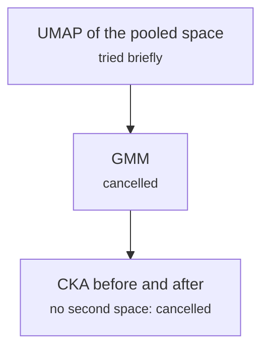

# research/representation_analysis.py

Encoding research · Ricky · P5 · due 10 Oct 2026 · Cancelled

UMAP, GMM and CKA on the fine-tuned spaces, as planned in A2. With the encoder frozen the space is fixed, so the head is inspected instead.

> Replaced by the head inspection of fd_10_nn_inspect.py.

## What it does

The Assignment 2 representation analysis compared the pooled space before and after fine-tuning. With a frozen encoder there is no second space to compare, so the analysis moved to the head: the random-label control, the label audit, the Hessian, seed connectivity and probes of fd_10.

## Architecture

## Depends on

- [research/finetune_encoder.py](research-finetune-encoder-py.md)

## Affects

- [fs_detailed/fd_10_nn_inspect.py](fs-detailed-fd-10-nn-inspect-py.md)

## Reads and writes

| Reads | Writes |
|---|---|
| `nothing on disk` | `nothing on disk` |

## Todos

- [ ] ~~UMAP and GMM of the pooled space~~ (Johnny, 0.5 h, 9 Oct), cancelled
- [ ] ~~CKA between the fine-tuned and the frozen space~~ (Ricky, 0 h, 10 Oct), cancelled

Open items live as sub-issues of the program's issue: [open it on GitHub](https://github.com/hputhireth/Technology-and-Design/issues?q=is%3Aissue+label%3Aprogram+%22research-representation-analysis-py%22).

## Meetings

| Date | Rating | Note |
|---|---|---|
| 10 Oct 2026 | 3/5 | With the encoder frozen the space is fixed; the head is what we inspect. |

## Hours

0.5 h over 2 todos, 0 h done. By week: Before the sprints 0.5 h.

[Back to the backlog](../README.md) · [Pipeline map](../PIPELINE.md)
