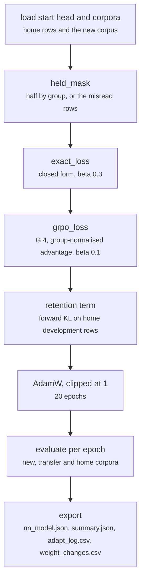

# scripts/adapt.py

Final pipeline · Ricky · P1 · due 2 Nov 2026 · Complete

Step 8: the leashed objective in two forms, the closed form and GRPO, all rows or the misread rows, with the retention term. Eight runs in 3 min 19 s.

## What it does

Moves a trained head to a new corpus without losing what it knows. exact_loss fits the head to softmax(log pi_ref + onehot(y) / beta) at beta 0.3; grpo_advantage and grpo_loss sample four classes per row, centre and scale the rewards within the group and take the policy gradient with beta 0.1 on the KL to the starting head. Under both a retention term, the forward KL on the head's own development rows, holds the old readings. Half of the new corpus is held out by group; --rows wrong trains only on the misread rows of the training half. CH-05 of the chain: the eight runs; the two shipped GRPO stages repeated on three seeds.

## Architecture

## Depends on

- [scripts/train.py](scripts-train-py.md)
- [scripts/predict.py](scripts-predict-py.md)
- [configs/finance.json](configs-finance-json.md)
- [common/head.py](common-head-py.md)
- [common/metrics.py](common-metrics-py.md)
- [common/sets.py](common-sets-py.md)
- [common/text.py](common-text-py.md)
- [fs_detailed/ed_12_rl.py](fs-detailed-ed-12-rl-py.md)
- [fs_detailed/ed_rl_mistakes.py](fs-detailed-ed-rl-mistakes-py.md)

## Affects

- [tests/integration/check_results.py](tests-integration-check-results-py.md)
- [sentiment-app/build_models.py](sentiment-app-build-models-py.md)
- [docs/presentation/](docs-presentation.md)

## Reads and writes

| Reads | Writes |
|---|---|
| `results/<config>/train/nn_model.json` | `results/<config>/adapt/<run>/nn_model.json` |
| `features of both corpora` | `summary.json` |
| `configs/*.json` | `adapt_log.csv` |
|  | `predictions_<set>.csv` |
|  | `weight_changes.csv` |

## Todos

- [x] The closed form (exact) with the retention term (Ricky, 0.5 h, 29 Oct)
- [x] GRPO with the group-normalised advantage (Ricky, 0.5 h, 30 Oct)
- [x] --rows wrong, the eight runs, three seeds for the two shipped stages (Ricky, 0.5 h, 2 Nov)

Open items live as sub-issues of the program's issue: [open it on GitHub](https://github.com/hputhireth/Technology-and-Design/issues?q=is%3Aissue+label%3Aprogram+%22scripts-adapt-py%22).

## Meetings

| Date | Rating | Note |
|---|---|---|
| 30 Oct 2026 | 4/5 | The closed form and GRPO side by side at the Sprint 3 review. |
| 3 Nov 2026 | 5/5 | 84.4 (sd 0.2) for 78.8 kept; the dialogue head at 78.6 with its emotion reading intact. |

## Hours

1.5 h over 3 todos, 1.5 h done. By week: Sprint 3 1 h, Sprint 4 0.5 h.

[Back to the backlog](../README.md) · [Pipeline map](../PIPELINE.md)
