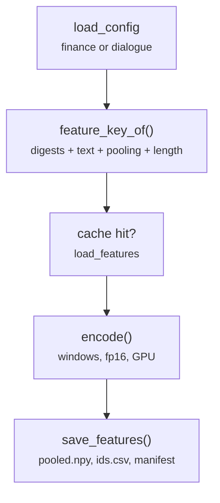

# scripts/encode.py

Final pipeline · Ricky · P1 · due 28 Oct 2026 · Complete

Step 2: the frozen encoder over every prepared set, fp16 on one GPU; skips a set whose key is in the cache. CH-02: 33 seconds.

## What it does

For each prepared set of a config it computes the feature key from the encoder digests, the text column, the pooling and the length settings, loads the cache if the key exists and otherwise runs the windowed forward pass and saves the features. On 3 November the three caches were found under their hashes, so the job took 33 seconds (7.8 GPU-minutes when they were first written).

## Architecture

## Depends on

- [scripts/prepare.py](scripts-prepare-py.md)
- [common/cache.py](common-cache-py.md)
- [common/encoder.py](common-encoder-py.md)
- [common/paths.py](common-paths-py.md)

## Affects

- [scripts/train.py](scripts-train-py.md)
- [scripts/predict.py](scripts-predict-py.md)
- [scripts/adapt.py](scripts-adapt-py.md)
- [scripts/linear.py](scripts-linear-py.md)
- [tests/integration/check_results.py](tests-integration-check-results-py.md)

## Reads and writes

| Reads | Writes |
|---|---|
| `data/cache/<config>/*.csv` | `features/<key>/pooled.npy` |
| `hf_cache/` | `ids.csv` |
|  | `manifest.json` |

## Todos

- [x] The encoder over every prepared set; skip when the cache has the key (Ricky, 0.5 h, 28 Oct)

Open items live as sub-issues of the program's issue: [open it on GitHub](https://github.com/hputhireth/Technology-and-Design/issues?q=is%3Aissue+label%3Aprogram+%22scripts-encode-py%22).

## Meetings

| Date | Rating | Note |
|---|---|---|
| 28 Oct 2026 | 4/5 | Walkthrough of the lean repository. |

## Hours

0.5 h over 1 todos, 0.5 h done. By week: Sprint 3 0.5 h.

[Back to the backlog](../README.md) · [Pipeline map](../PIPELINE.md)
