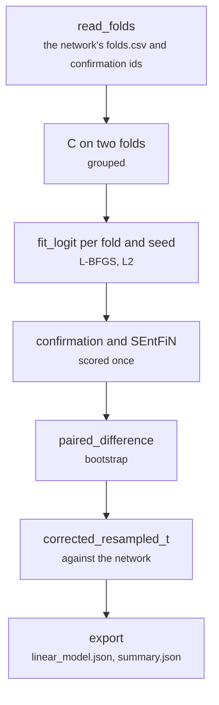

# scripts/linear.py

Final pipeline · Ricky · P2 · due 31 Oct 2026 · Complete

The linear control: ridge logistic regression on the same 2,048 features, the network's folds and confirmation rows, paired by the corrected t-test.

## What it does

Reads the network's folds.csv and confirmation ids so that the control sees exactly the same rows, chooses C on two folds, fits the multinomial logit with L-BFGS on every fold and seed, scores the confirmation split and SEntFiN, and pairs the fold-by-seed macro-F1 against the network with the corrected resampled t-test and a paired bootstrap. CH-06: 66 min 42 s, the longest job of the chain (L-BFGS makes several hundred passes over a 360 MB matrix per fit).

## Architecture

## Depends on

- [scripts/train.py](scripts-train-py.md)
- [common/metrics.py](common-metrics-py.md)
- [common/head.py](common-head-py.md)
- [common/sets.py](common-sets-py.md)
- [fs_detailed/fd_linear.py](fs-detailed-fd-linear-py.md)

## Affects

- [tests/integration/check_results.py](tests-integration-check-results-py.md)
- [docs/A3_Design_Document.docx](docs-a3-design-document-docx.md)

## Reads and writes

| Reads | Writes |
|---|---|
| `results/<config>/train/folds.csv` | `results/<config>/linear/linear_model.json` |
| `confirmation_ids.csv` | `summary.json` |
| `features` | `cv_runs.csv` |
|  | `<set>/predictions.csv` |

## Todos

- [x] Ridge logistic regression on the network's folds and confirmation rows (Ricky, 0.5 h, 30 Oct)
- [x] C on two folds; the paired bootstrap and the corrected t-test; the job of Sat 31 Oct 21:13 (Ricky, 0.5 h, 31 Oct)

Open items live as sub-issues of the program's issue: [open it on GitHub](https://github.com/hputhireth/Technology-and-Design/issues?q=is%3Aissue+label%3Aprogram+%22scripts-linear-py%22).

## Meetings

| Date | Rating | Note |
|---|---|---|
| 31 Oct 2026 | 4/5 | +0.018 macro-F1 for the hidden layers on FinGPT, p 5e-8; a tie on the dialogue data. |

## Hours

1 h over 2 todos, 1 h done. By week: Sprint 3 0.5 h, Sprint 4 0.5 h.

[Back to the backlog](../README.md) · [Pipeline map](../PIPELINE.md)
