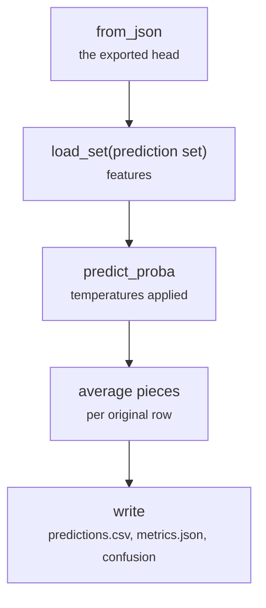

# scripts/predict.py

Final pipeline · Ricky · P2 · due 29 Oct 2026 · Complete

A trained head on every prediction set: pieces averaged per original row, metrics where labels exist. Seconds, inside the train job.

## What it does

Loads the exported head, runs it on the cached features of each prediction set, averages the pieces of a long text per original row, writes predictions.csv with the probabilities of every reading and metrics.json with a confusion matrix where the set has labels. sbatch slurm/predict.sh <config> prepares and encodes a new file under data/raw/predict/ first.

## Architecture

## Depends on

- [scripts/train.py](scripts-train-py.md)
- [scripts/encode.py](scripts-encode-py.md)
- [common/head.py](common-head-py.md)
- [common/metrics.py](common-metrics-py.md)
- [common/sets.py](common-sets-py.md)

## Affects

- [scripts/adapt.py](scripts-adapt-py.md)
- [tests/integration/check_results.py](tests-integration-check-results-py.md)
- [sentiment-app/build_models.py](sentiment-app-build-models-py.md)

## Reads and writes

| Reads | Writes |
|---|---|
| `results/<config>/train/nn_model.json` | `results/<config>/<set>/predictions.csv` |
| `features of the prediction sets` | `metrics.json` |

## Todos

- [x] A trained head on every prediction set; pieces averaged per original row (Ricky, 0.5 h, 29 Oct)

Open items live as sub-issues of the program's issue: [open it on GitHub](https://github.com/hputhireth/Technology-and-Design/issues?q=is%3Aissue+label%3Aprogram+%22scripts-predict-py%22).

## Meetings

| Date | Rating | Note |
|---|---|---|
| 29 Oct 2026 | 4/5 | predict.py walked through. |

## Hours

0.5 h over 1 todos, 0.5 h done. By week: Sprint 3 0.5 h.

[Back to the backlog](../README.md) · [Pipeline map](../PIPELINE.md)
