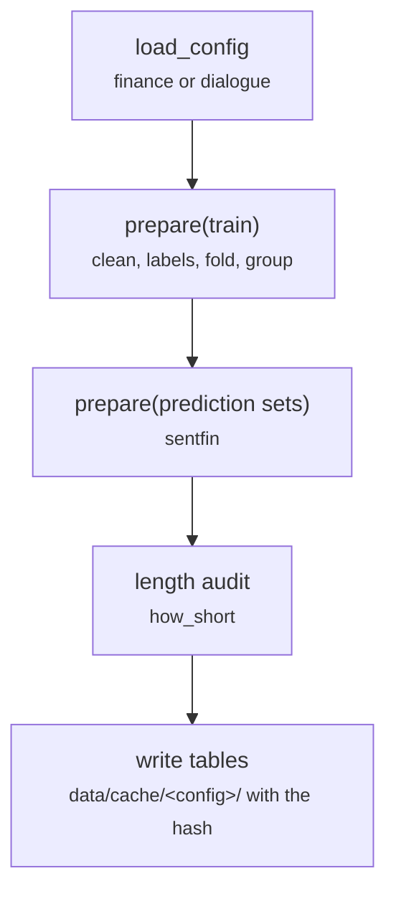

# scripts/prepare.py

Final pipeline · Ricky · P1 · due 28 Oct 2026 · Complete

Step 1: clean, normalise the labels, fold duplicates, group, and write one table per set with a content hash. Seconds, on the login node.

## What it does

For one config: reads the raw training file and every prediction file, cleans the text, puts the labels on their configured names, folds exact duplicates of the training set with a count, assigns groups (near-duplicate key for finance, conversation for dialogue) and writes the prepared tables with a manifest, label counts and a length audit (how_short). CH-01 of the chain: 6 seconds for both corpora.

## Architecture

## Depends on

- [configs/finance.json](configs-finance-json.md)
- [common/paths.py](common-paths-py.md)
- [common/text.py](common-text-py.md)
- `data/raw/`

## Affects

- [scripts/encode.py](scripts-encode-py.md)
- [scripts/train.py](scripts-train-py.md)
- [scripts/predict.py](scripts-predict-py.md)
- [tests/integration/check_results.py](tests-integration-check-results-py.md)

## Reads and writes

| Reads | Writes |
|---|---|
| `data/raw/fs_train.csv` | `data/cache/<config>/train.csv` |
| `data/raw/empathetic_training.csv` | `sentfin.csv` |
| `data/raw/predict/sentfin.csv` | `manifest.json` |
|  | `label_counts.json` |
|  | `length_audit.json` |

## Todos

- [x] Step 1 for both configs; the content hash on every table; the length audit (Ricky, 0.5 h, 28 Oct)

Open items live as sub-issues of the program's issue: [open it on GitHub](https://github.com/hputhireth/Technology-and-Design/issues?q=is%3Aissue+label%3Aprogram+%22scripts-prepare-py%22).

## Meetings

| Date | Rating | Note |
|---|---|---|
| 28 Oct 2026 | 4/5 | Walkthrough of the lean repository. |

## Hours

0.5 h over 1 todos, 0.5 h done. By week: Sprint 3 0.5 h.

[Back to the backlog](../README.md) · [Pipeline map](../PIPELINE.md)
