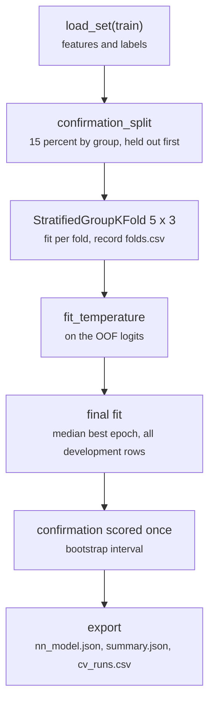

# scripts/train.py

Final pipeline · Ricky · P1 · due 29 Oct 2026 · Complete

Steps 3 to 7: confirmation split, StratifiedGroupKFold 5 x 3 on the chosen configuration, temperature, final fit, confirmation scored once, export.

## What it does

Holds the confirmation split out first, runs the grouped folds by seed on the fixed configuration and records every validation fold in folds.csv (read by the controls and the integration test), fits one temperature per reading on the out-of-fold logits, refits on all development rows for the median best epoch, scores the confirmation split once with a bootstrap interval and exports the head. CH-03 and CH-04 of the chain: 9 min 10 s for finance, 6 min 25 s for dialogue; both networks came back to the fourth decimal of the research pipeline's numbers.

## Architecture

## Depends on

- [scripts/encode.py](scripts-encode-py.md)
- [scripts/prepare.py](scripts-prepare-py.md)
- [configs/finance.json](configs-finance-json.md)
- [common/head.py](common-head-py.md)
- [common/metrics.py](common-metrics-py.md)
- [common/sets.py](common-sets-py.md)
- [common/text.py](common-text-py.md)

## Affects

- [scripts/predict.py](scripts-predict-py.md)
- [scripts/adapt.py](scripts-adapt-py.md)
- [scripts/linear.py](scripts-linear-py.md)
- [scripts/words.py](scripts-words-py.md)
- [tests/integration/check_results.py](tests-integration-check-results-py.md)
- [sentiment-app/build_models.py](sentiment-app-build-models-py.md)

## Reads and writes

| Reads | Writes |
|---|---|
| `data/cache/<config>/train.csv` | `results/<config>/train/nn_model.json` |
| `features/<key>/pooled.npy` | `summary.json` |
| `configs/<config>.json` | `cv_runs.csv` |
|  | `folds.csv` |
|  | `confirmation_ids.csv` |
|  | `confusion_<reading>.csv` |

## Todos

- [x] Steps 3 to 7 on the chosen configuration (Ricky, 0.5 h, 29 Oct)
- [x] folds.csv per seed and the confirmation recall in summary.json (Ricky, 0.5 h, 1 Nov)

Open items live as sub-issues of the program's issue: [open it on GitHub](https://github.com/hputhireth/Technology-and-Design/issues?q=is%3Aissue+label%3Aprogram+%22scripts-train-py%22).

## Meetings

| Date | Rating | Note |
|---|---|---|
| 29 Oct 2026 | 4/5 | train.py walked through against Appendix B. |
| 3 Nov 2026 | 5/5 | The two networks reproduce to the fourth decimal. |

## Hours

1 h over 2 todos, 1 h done. By week: Sprint 3 0.5 h, Sprint 4 0.5 h.

[Back to the backlog](../README.md) · [Pipeline map](../PIPELINE.md)
