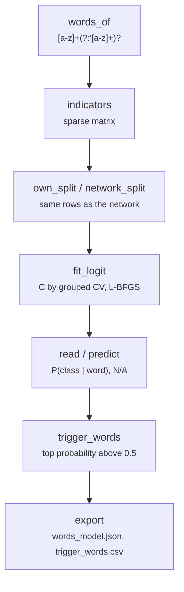

# scripts/words.py

Final pipeline · Ricky · P2 · due 31 Oct 2026 · Complete

The word logit: a multinomial logit on word indicators, identified by its ridge penalty, one model per corpus, with its trigger words. The control for the encoder.

## What it does

words_of reads the distinct words of a text; indicators builds the sparse matrix; fit_logit fits the multinomial logit with L2 by L-BFGS with C chosen by grouped cross-validation; read and predict score a text word by word with N/A for a text with no known word; trigger_words lists the words whose top class probability exceeds 0.5 (4,648 on SEntFiN). CH-07: 7 min 31 s for the three models. The trigger table is written with six decimals after a word at 0.50004 recomputed on the other side of 0.5.

## Architecture

## Depends on

- [scripts/prepare.py](scripts-prepare-py.md)
- [common/text.py](common-text-py.md)
- [common/metrics.py](common-metrics-py.md)
- [models/general_tfidf_logreg.py](models-general-tfidf-logreg-py.md)

## Affects

- [tests/integration/check_results.py](tests-integration-check-results-py.md)
- [sentiment-app/app.py](sentiment-app-app-py.md)
- [docs/A3_Design_Document.docx](docs-a3-design-document-docx.md)

## Reads and writes

| Reads | Writes |
|---|---|
| `data/cache/<config>/<set>.csv` | `results/<config>/words/<set>/words_model.json` |
| `results/<config>/train/folds.csv` | `summary.json` |
|  | `trigger_words.csv` |
|  | `cv_runs.csv` |

## Todos

- [x] Word indicators and the multinomial logit identified by its penalty (Ricky, 0.5 h, 30 Oct)
- [x] Trigger words, the N/A reading, one model per corpus (Ricky, 0.5 h, 31 Oct)
- [x] Six decimals in trigger_words.csv after the 0.50004 catch (Ricky, 0.5 h, 3 Nov)

Open items live as sub-issues of the program's issue: [open it on GitHub](https://github.com/hputhireth/Technology-and-Design/issues?q=is%3Aissue+label%3Aprogram+%22scripts-words-py%22).

## Meetings

| Date | Rating | Note |
|---|---|---|
| 31 Oct 2026 | 4/5 | FinGPT at 71.0, SEntFiN at 58.9 zero-shot and 79.8 in domain. |
| 3 Nov 2026 | 3/5 | A word at 0.50004 recomputed on the other side of 0.5; six decimals now. |

## Hours

1.5 h over 3 todos, 1.5 h done. By week: Sprint 3 0.5 h, Sprint 4 1 h.

[Back to the backlog](../README.md) · [Pipeline map](../PIPELINE.md)
