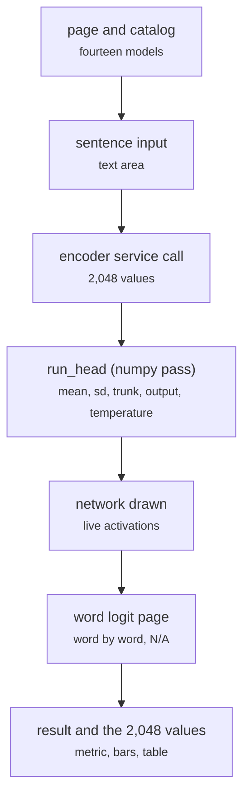

# sentiment-app/app.py

Front end · Hara · P1 · due 1 Nov 2026 · Complete

The Streamlit application: a sentence through any of the fourteen models, the network drawn with its live activations, the word logit word by word.

## What it does

Hara's application, built from the first experiments of 12 October to the first deployment of 25 October and the redeployment of all fourteen models on 1 November. It reads the model store, calls the encoder service for a new sentence, runs the heads on a CPU with the same numpy pass the unit tests use, draws the network a sentence passes through with the calculation steps, and reads a sentence word by word for the word logit with N/A for unknown words. 368 statements, 99 percent covered.

## Architecture

## Depends on

- [sentiment-app/build_models.py](sentiment-app-build-models-py.md)
- [fd_encode_server.py](fd-encode-server-py.md)
- [scripts/words.py](scripts-words-py.md)

## Affects

- [sentiment-app/tests/](sentiment-app-tests.md)
- [sentiment-app/README.md and the deployment](sentiment-app-readme-md-and-the-deployment.md)
- [deploy/Dockerfile](deploy-dockerfile.md)
- [docs/presentation/](docs-presentation.md)

## Reads and writes

| Reads | Writes |
|---|---|
| `the model store built by build_models.py` | `nothing on disk` |

## Todos

- [x] Read the FinGPT Network export into the page (Hara, 5 h, 21 Oct)
- [x] The Dialogue Network page: two readings from one trunk (Hara, 2.5 h, 26 Oct)
- [x] All fourteen models on the page; the catalog (Hara, 2.5 h, 31 Oct)
- [x] Streamlit experiments: layout, reading an export, the sentence tool (Hara, 6 h, 13 Oct)
- [x] The sentence tool: a text box, the encoder call, the probabilities (Hara, 3 h, 15 Oct)
- [x] Reading an export: the JSON form of a head (Hara, 2 h, 16 Oct)
- [x] The network drawn with its live activations (Hara, 3 h, 22 Oct)
- [x] The adapted heads: before and after on a sentence (Hara, 2 h, 28 Oct)
- [x] The word-logit query page: a sentence word by word, N/A for unknown words (Hara, 2 h, 30 Oct)
- [x] Mock-up of the pages for the live-testing check (Johnny, 2 h, 13 Oct)
- [x] Streamlit experiments alongside Hara (Johnny, 3 h, 14 Oct)
- [x] Front-end supervision: pages presentable and consistent (Johnny, 1.5 h, 22 Oct)
- [x] Front-end supervision, Sprint 3 (Johnny, 1.5 h, 28 Oct)
- [x] Front-end supervision, Sprint 4 (Johnny, 1 h, 1 Nov)

Open items live as sub-issues of the program's issue: [open it on GitHub](https://github.com/hputhireth/Technology-and-Design/issues?q=is%3Aissue+label%3Aprogram+%22sentiment-app-app-py%22).

## Meetings

| Date | Rating | Note |
|---|---|---|
| 16 Oct 2026 | 3/5 | First Streamlit experiments shown at the Sprint 1 review. |
| 23 Oct 2026 | 4/5 | The FinGPT Network export read into the page. |
| 30 Oct 2026 | 4/5 | The Dialogue Network page and the adapted heads. |
| 1 Nov 2026 | 5/5 | All fourteen models live. |

## Hours

37 h over 14 todos, 37 h done. By week: Sprint 1 16 h, Sprint 2 9.5 h, Sprint 3 8 h, Sprint 4 3.5 h.

[Back to the backlog](../README.md) · [Pipeline map](../PIPELINE.md)
