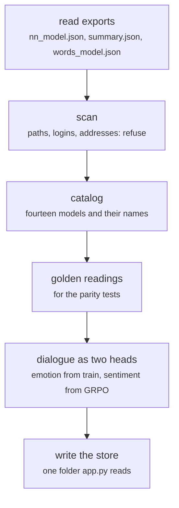

# sentiment-app/build_models.py

Front end · Hara · P1 · due 9 Nov 2026 · In progress

The model store: reads the exported float16 weights and JSON summaries, refuses any file carrying a path or a login. To be rebuilt from the 3 November exports.

## What it does

Builds the store app.py reads from the exports of the pipeline: the trained networks, the adapted heads, the two controls and the word tables, with the golden readings for the parity tests. Every export and summary is scanned for home paths, logins and addresses and refused if one is found. The store still holds the October exports; it is to be rebuilt from the chain of 3 November, with the dialogue model shipped as two heads on the same features, emotion from dialogue/train and sentiment from dialogue/adapt/finance_train_grpo.

## Architecture

## Depends on

- [scripts/train.py](scripts-train-py.md)
- [scripts/predict.py](scripts-predict-py.md)
- [scripts/adapt.py](scripts-adapt-py.md)
- [scripts/linear.py](scripts-linear-py.md)
- [scripts/words.py](scripts-words-py.md)
- [common/head.py](common-head-py.md)
- [tests/forbidden_patterns.py](tests-forbidden-patterns-py.md)

## Affects

- [sentiment-app/app.py](sentiment-app-app-py.md)
- [sentiment-app/tests/](sentiment-app-tests.md)
- [deploy/Dockerfile](deploy-dockerfile.md)

## Reads and writes

| Reads | Writes |
|---|---|
| `results/**/nn_model.json` | `the model store` |
| `summary.json` | `golden_readings.json` |
| `words_model.json` |  |
| `trigger_words.csv` |  |

## Todos

- [x] Read the exported float16 weights and JSON summaries into the model store (Hara, 2.5 h, 27 Oct)
- [x] Scan every export and summary for home paths, logins and addresses; refuse the file (Hara, 1 h, 29 Oct)
- [ ] Rebuild the store from the exports of the 3 November chain (Hara, 2 h, 5 Nov), in progress
- [ ] The dialogue model as two heads: emotion from dialogue/train, sentiment from dialogue/adapt/finance_train_grpo (Hara, 2 h, 8 Nov), todo
- [ ] Parity against the 3 November summaries (ST-P-01) and redeploy (Hara, 1.5 h, 9 Nov), todo
- [ ] Which files carry which head, checked against results/README.md (Ricky, 1 h, 8 Nov), todo

Open items live as sub-issues of the program's issue: [open it on GitHub](https://github.com/hputhireth/Technology-and-Design/issues?q=is%3Aissue+label%3Aprogram+%22sentiment-app-build-models-py%22).

## Meetings

| Date | Rating | Note |
|---|---|---|
| 30 Oct 2026 | 4/5 | The store and its scan reviewed. |
| 5 Nov 2026 | 3/5 | The store still holds the October exports; the rebuild is planned for the weekend. |

## Hours

10 h over 6 todos, 3.5 h done. By week: Sprint 3 3.5 h, Sprint 4 2 h, Final week 4.5 h.

[Back to the backlog](../README.md) · [Pipeline map](../PIPELINE.md)
